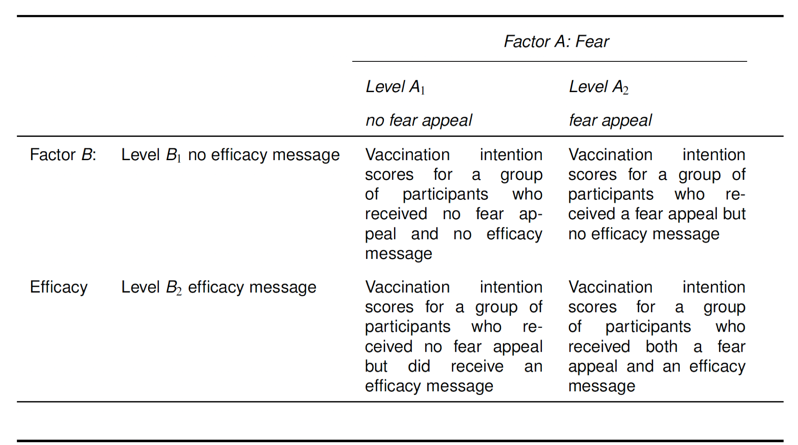
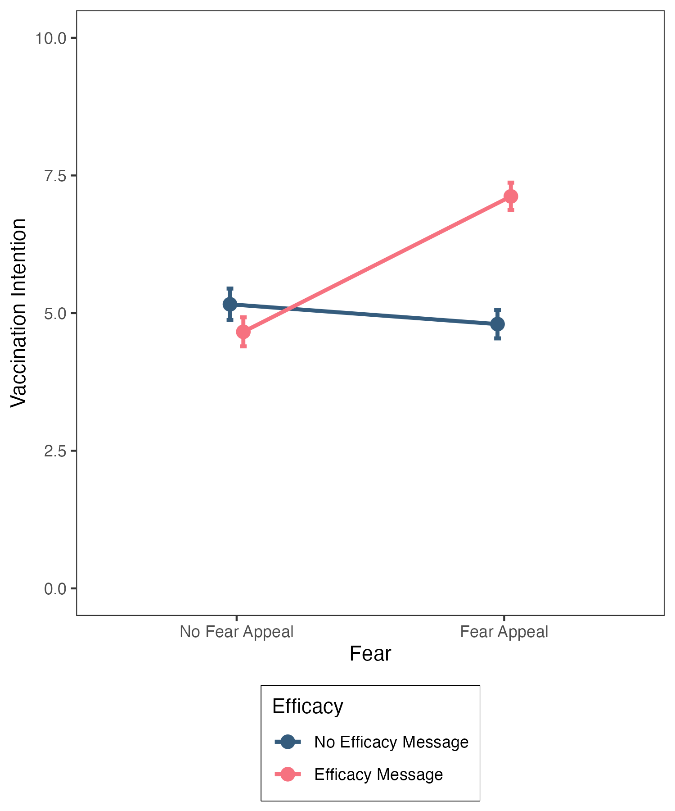

# Lectures

Thanks for your concentration and commitment to working with PsychoPy in the labs last week.  I hope that the simple introduction, if long winded, was useful to you and that, although your final-year dissertation project is some way away, you can see the potential for PsychoPy as a tool for your own independent research design and execution.

To further that aim, in this week's Lecture 1 (and lab), we look at how to use PsychoPy builder to create a workflow for either a) a Stroop Task or b) the Visual Perespective Taking experiment.  As you watch the lecture, take special note of the middle section as that will be useful to you for the first half of the lab session.

For Lecture 2, I have decided to let Mark speak his truth about the analysis of variance method for two-factor between-participants design.  The lecture is pristine for all the important aspects, and while we are in this transitional space between experimental software, I figured you can continue to learn from the Master, rather than the Apprentice.  The second half of the lab session, as in week 5, will be concerned with applying the steps taken in this lecture.

When you go to the lecture for the statistics content,  you will see that this content has previously occupied the week 7 space of a statistics module.  You will also see this on the slides.  This is not an important consideration.  The learning content is good for week 6 of this module for this year.  Thank you for understanding this and not freaking out!

Watch Lecture 1 [here](https://lancaster.cloud.panopto.eu/Panopto/Pages/Viewer.aspx?id=06b1ca30-5a0d-4e4c-b6f3-b4f6010b7164&start=0)

Download Lecture 1 slides [here](data/Wk6/Week 6 lecture 1 RT Slides.pptx)

Watch Lecture 2 Part 1 [here](https://lancaster.cloud.panopto.eu/Panopto/Pages/Viewer.aspx?id=303bc7f8-9752-4453-925a-af510084b648)

Watch Lecture 2 Part 2 [here](https://lancaster.cloud.panopto.eu/Panopto/Pages/Viewer.aspx?id=01f3f574-690a-40dd-9725-af51008cf954)

Watch Lecture 2 Part 3 [here](https://lancaster.cloud.panopto.eu/Panopto/Pages/Viewer.aspx?id=d8ce2e3d-c7ad-4293-a3f3-af5100912abc)

Watch Lecture 2 Part 4 [here](https://lancaster.cloud.panopto.eu/Panopto/Pages/Viewer.aspx?id=49c1c503-2896-400f-9efd-af5100b172b7)

Watch Lecture 2 Part 5 [here](https://lancaster.cloud.panopto.eu/Panopto/Pages/Viewer.aspx?id=1a6ddc87-22ac-4990-8208-af5200cb54de)

Download the lecture slides [here](data/Wk6/Two-Factor Between-Participants Designs HANDOUT.pdf), and [here](data/Wk6/Two-Factor Between-Participants Designs.pdf) for a larger version.

# This Week's Lab

```{r setup, include=FALSE}
knitr::opts_chunk$set(echo = TRUE)
```

The lab is in two parts again.

Part 1: Accessing PsychoPy using the same procedure as last week, this time it is your time to build an experiment in PsychoPy so that you get an idea of how easy it is to use from a very small amount of learning / information.  The aim of this part of the lab is for you to have an experience of interacting with PsychoPy as a *researcher* this time, rather than a participant as you did last week.

Part 2: Around the turn of the hour, turn back to the statistics and follow the code to apply the concepts and practical steps demonstrated by Mark in the lecture.

## Learning Objectives

By the end of the lab you should be able to: 

- Create a basic experimental workflow in PsychoPy
- Link columns in an excel spreadsheet with elements of an experimental trial
- Perform an ANOVA to establish whether either of the two main effects or interaction is significant
- Understand when to perform a simple main effects analysis
- Perform a simple main effects analysis
- Report the results in a results section standard paragraph for a factorial ANOVA

**Note: today, and in future lab sessions, we will only be providing code for new commands that you have not previously done. From now on, you will be generating your own code for a large portion of the lab exercises. So, it would be a good idea to have the lab class materials from previous weeks readily accessible to remind you how to accomplish different tasks.**

**There are hints in the webpage main body text - please take time to read this and make sense of it to help you as you use earlier code as a model for your new code; we have put 'check your answer' boxes throughout and the staff can also assist**

::: {.callout-note icon="false"}
## Session plan: 1 hour 50 mins

| Activity | Approximate time |
|---|---:|
| Set up | 5 minutes |
| Part 1: Task 1: Access virtual desktop, AppsAnywhere and PsychoPy | 5 minutes |
| Part 1: Task 1: Build a short experiment in PsychoPy Builder | 40 mins |
| Part 1: Reflect on basic researcher experience in PsychoPy | 10 minutes |
| Part 2: Set up - load data (you could do this before the lab!) | 10 minutes |
| Part 2: Generating descriptives and checking assumptions data - some code writing | 20 minutes |
| Part 2: Running ANOVA and simple main effects analysis | 20 minutes |
:::

Part 1: Building an Experiment in PsychoPy

You have but four hours of exposure to PsychoPy and so I want to equip you with the knowledge of how to source helpful information for yourself, with the aim to give you confidence to play / create in PsychoPy pretty independently.  If you can build a basic experiment, this will give you a mental map or headspace where you can visualise potential experimental design when considering research questions.

For this reason, the information for this exercise is located in Chapter 2 of the PsychoPy manual. You can access the manual [through the library](https://onesearch.lancaster-university.uk/permalink/44LAN_INST/1lfre6e/alma9931315651301221)

You have a choice of which experiment to build:

Choice 1: Follow the instructions in Chapter 2 to build a version of the Stroop task. The Stroop task is talked about in this week's statistics lecture.  It is a very well known task and effect.

If you choose this version of the task, the trade off is that you will need to create the Excel file from scratch.  There are instructions for how to lay it out in the chapter.

Choice 2: Use the instructions in Chapter 2 as a model for how to recreate the VPT task that you experienced last week.  You already have the Excel spreadsheet `VPTtrial.xlsx` in the VPT folder you downloaded last week. Make two blocks instead of three or four.

If you choose this version of the task, the trade off is that you need to mentally adapt the instructions to the VPT task as you go along.  So the learning here is not only how to build in PsychoPy but also how to use model tasks to achieve a similar task on your own.

For both tasks, whichever you choose, I do recommend that you work together as a table to achieve the task in the following way:

1. One person on the table logs into the computer that is linked to the big screen / connect their computer to the big screen and accesses PsychoPy as in Lab 5.  We will label this person the driver for this task
2. One person also opens PsychoPy on their computer as before.  They are second driver
3. The other people open the chapter 2 of the manual and prepare to act as a reference or direct the drivers.  We will call these people the navigators.

approaching the task this way will mitigate the problem of computers with small screens attempting to use half screen's while working.  Having more space will smooth the workflow.
 
4. Together, go through the steps to achieve the task. Navigators read the "map" (the chapter) and direct the drivers with where to go and what to do. Support each other in the task.

This way of working is based on a table of four; it could work with a table of three - in which case I suggest one navigator and two drivers; on a table of two then one navigator and one driver.  If you have to do it on your own, then good luck to you.

Try not to be too focussed on *getting it right* here; focus more on this is a process, there are bound to be hiccups.  Glitches and bugs are about as certain in a research psychologist's role as death and taxes to everybody!  The principle is that by having a go at building, you are more likely to understand where a bug could occur for when an occasion arises for de-bugging.

Part 2: Two-by-two ANOVA Analysis Method

At this point, you should be able to access the web page and your RStudio account on the department server without the long instructions.  If you need to refer to them, then access them from previous weeks' content and adapt the file / folder / project names to reflect the correct week for the lab. Download this week's data file: [fearVac.csv](data/Wk6/fearVac.csv) and upload it to this week's folder.

After opening a new R script, load the relevant libraries that we will be using in today's session.

```{r, message = FALSE}
library("tidyverse")  # For data storage and manipulation
library("tidyr")      # For tidy data
library("rstatix")    # For descriptives statistics, outlier detection etc.
library("effectsize") # For generating effect sizes for the ANOVA and simple main effects
library("ggpubr")     # For generating Q-Q plots
library("phia")       # For calculating simple main effects
```

# Today's Lab Activities

## Analysing the Hypothetical COVID-19 Vaccination Study Data

Today, we are going to analyse the hypothetical COVID-19 vaccination study data that we plotted in last week's lab session (fearVac.csv). As a reminder, the table below summarises the four different conditions of our 2 $\times$ 2 between-participant study.

{width=75%}

The data set consists of the following four columns:

* **Par:** represents the participant number, which ranges from 1--200, with $N$ = 50 participants in each of the four conditions resulting from the combination of our two factors, described next. 

* **Fear:** represents whether the participant indicated by the row received (Fear Appeal) or did not receive (No Fear Appeal) the fear appeal.

* **Efficacy:** represents whether the participant indicated by the row received (Efficacy Message) or did not receive (No Efficacy Message) the efficacy message.

* **Likelihood:** represents the vaccination likelihood score of the participant indicated by the row.

The first thing you need to do is load the data into RStudio. Name the imported file `lab6_raw` and then make a working copy as `lab6_data`.

By default, R will import these variables as characters, in which case the variables would have the labels `<chr>` beneath them. If that is the case for your data, then you will need to modify this before proceeding further.   

Hopefully, you are already thinking - okay, I need to re-level the factors `Fear` and `Efficacy` so that "No Fear Appeal" is the baseline level for the former factor, and "No Efficacy Message" is the baseline level for the latter factor. This would be good statistical thinking.  Plus - you made this code in last week's lab so go and find it, create yourself a new, pristine `r` chunk and transform those variables!

::: {.callout-warning icon="false" collapse="true"}
## Answer
```{r, echo=TRUE, message=FALSE, warning=FALSE, eval=FALSE}
# Import the data
lab6_raw = read_csv("fearVac.csv")

# make a second working copy
lab6_data <- lab6_raw

# Convert "Fear" and "Efficacy" into factors: ensure that "No Fear Appeal" is Level 1 of the Fear factor and "No Efficacy Message" is Level 1 of the Efficacy factor
lab6_data$Fear = factor(lab6_data$Fear, levels = c("No Fear Appeal","Fear Appeal"))
lab6_data$Efficacy = factor(lab6_data$Efficacy, levels = c("No Efficacy Message","Efficacy Message"))
(lab6_data)
```
:::

Once you have done the above, type `(lab6_data)` into the console to view the first 10 rows of the data. We want to check that the columns for `Fear` and `Efficacy` have the labels `<fct>` beneath them---see the output below. This means that R has stored these variables as factors, which is necessary for us to perform the ANOVA. 

```{r, echo = FALSE, message = FALSE}
lab6_data = read_csv("data/Wk6/fearVac.csv")
# The following ensures that "No Fear Appeal" is Level 1 of the Fear factor and "No Efficacy Message" is Level 1 of the Efficacy factor
lab6_data$Fear = factor(lab6_data$Fear, levels = c("No Fear Appeal","Fear Appeal"))
lab6_data$Efficacy = factor(lab6_data$Efficacy, levels = c("No Efficacy Message","Efficacy Message"))
(lab6_data)
```

### Descriptives statistics and assumption checks

The next step is to generate some descriptive statistics.  You have done this before many times, so you can generate these descriptive statistics for yourselves. 

This week, for the four conditions, we want to adapt descriptive statistics R code so that we generate:

- means, standard deviations, and confidence intervals (cis) for our four conditions.
- that the values for means, sds and cis are reported at 1 decimal place.

Tips:

1. There is a chunk of code in the week 5 lab that will give you the general structure for this step.  Notice however that `Intention` is no longer a variable in this dataset - what is its equivalent? You need to swap in this new name to adapt the code.
2. When you invoke the `group_by()` function, be sure to include the variables for both factors, `(Fear, Efficacy)` with a comma seperating them, as I have done here. 
3. Make sure you name your descriptive statistics `descriptives`, as we have done for the last two lab sessions. 
4. The `options(digits = what number will you put here to get values at 1 decimal place)` is the line of code that you need to adapt to get means etc to be reported for APA7 standard

::: {.callout-warning icon="false" collapse="true"}
## Answer

```{r, echo=TRUE, message=FALSE, warning=FALSE}
# Get descriptive statistics
descriptives = lab6_data %>%
  # Organise the output by the "Fear" and "Efficacy" factors
  group_by(Fear, Efficacy) %>%
  # Request means, standard deviations, and confidence intervals
  get_summary_stats(Likelihood, show = c("mean", "sd", "ci"))
  # Show enough digits to permit rounding to 2 decimal places
  options(digits = 2)
  # Print the results
  print.data.frame(descriptives)
```
:::

Once you have written and executed the code in RStudio, type `print.data.frame(descriptives)` in the console to view the descriptive statistics, it should yield the following output:

```{r, echo=FALSE, message=FALSE, warning=FALSE}
# Get descriptive statistics
descriptives = lab6_data %>%
  # Organise the output by the "Fear" and "Efficacy" factors
  group_by(Fear, Efficacy) %>%
  # Request means, standard deviations, and confidence intervals
  get_summary_stats(Likelihood, show = c("mean", "sd", "ci"))
  # Show enough digits to permit rounding to 2 decimal places
  options(digits = 2)
  # Print the results
  print.data.frame(descriptives)
```

We won't linger on these descriptive statistics because we inspected them in last week's lab session. 

The next steps are for us to perform our usual checks to make sure that the data are fit for analysis using ANOVA. 

The first check we are going to perform is to establish whether there are any outliers or extreme values in the data set. You have worked with code to achieve this in lab 3 so go and have a look there. A good tip here is to perform a key word search.  If you are in your own R script from the lab 3, use the magnifying glass icon to search.  If you return to the Week 3 lab page, press `Ctrl F` (on most keyboards - it might by `Cmd F` on a Mac) to perform a page search and search for the word 'outliers'. Adapt the code to identify if there are any outliers or extreme values. As per when you generated the descriptive statistics, remember we have two factors, so when you invoke `group_by()` you will need to include the arguments `(Fear, Efficacy)`.

::: {.callout-warning icon="false" collapse="true"}
## Answer

```{r, echo=TRUE, message=FALSE, warning=FALSE}
# Check for outliers and extreme values
lab6_data %>%
  # Organise the output by the "Fear" and "Efficacy" factors
  group_by(Fear,Efficacy) %>%
  # Identify outliers and extreme values
  identify_outliers("Likelihood")
```
:::

If you have entered your code correctly, then it should generate the following:

```{r, echo=FALSE, message=FALSE, warning=FALSE}
# Check for outliers and extreme values
lab6_data %>%
  # Organise the output by the "Fear" and "Efficacy" factors
  group_by(Fear,Efficacy) %>%
  # Identify outliers and extreme values
  identify_outliers("Likelihood")
```

There are only two outlier scores in the data, participant 28 who received the combination of No Fear Appeal/No Efficacy Message and participant 126 who received the combination of Fear Appeal/No Efficacy Message. Fortunately, there are no extreme values in the data, so we are safe to proceed without having to remove or transform any scores. 

The next check that we need to undertake is to ensure that the homogeneity of variance assumption has been met. As we have seen in previous lectures and labs, this is an important assumption for single factor between-participants ANOVA, and the same is true for between-participants *factorial* ANOVA. Applied to the latter, this assumption states that the variances for the different conditions created through the factorial combination of factors should not differ systematically from one another. For our 2 $\times$ 2 between-participants factorial design, this means that the variances for the four conditions created by the combination of our two factors should be roughly comparable.

We can test whether the data satisfy the homogeneity of variance assumption using Levene's test, as we did in lab 2. Retrieve the code from lab 2, as above, and adapt it for use here. In this lab, however, when you invoke Levene's test using `levene_test()` you will need to enter `(Likelihood ~ Fear * Efficacy)` as the arguments. The argument `Likelihood` is our dependent measure, and the argument `Fear * Efficacy` tells the function that we want to run the test on the four conditions created through the factorial combination of our two factors (that's what the `*` is for; note you can also substitute the `*` with `:` which has the same meaning and yields the same result).

::: {.callout-warning icon="false" collapse="true"}
## Answer

```{r, echo=TRUE, message=FALSE, warning=FALSE}
# Levene's test for homogeneity of variance
lab6_data %>% 
  levene_test(Likelihood ~ Fear * Efficacy)
```
:::

If you have entered your code correctly, then it should return the following output:

```{r, echo=FALSE, message=FALSE, warning=FALSE}
# Levene's test for homogeneity of variance
lab6_data %>% 
  levene_test(Likelihood ~ Fear * Efficacy)
```

The test result is non-significant (*p* = .875), which indicates that the variances of the four conditions do not differ appreciably from one another. Accordingly, based on Levene's criterion, we can be satisfied that the homogeneity of variance assumption has been satisfied.

The next check we need to perform is to ensure that our data satisfy the normality assumption. We can do this by running a Shapiro-Wilk test on the data for each of our four conditions to determine if the distribution of scores in each differs significantly from a normal distribution. Remember the rule for using this test---if there is less than $N$ = 50 observations per condition, the Shapiro-Wilk test is likely to yield an accurate test result, whereas if it is equal to or greater than this number, we are better off inspecting the Q-Q plots. Our sample size per condition is right on the threshold, so we will use both approaches to testing the normality assumption. 

You used code for Shapiro-Wilk and Q-Q plots in lab 2 also. Retrieve the code and adapt for this data. Just remember once again that when invoking the function `group_by` you need to supply the arguments `(Fear,Efficacy)` given that we have two factors.

::: {.callout-warning icon="false" collapse="true"}
## Answer

```{r, echo=TRUE, message=FALSE, warning=FALSE}
# Shapiro Wilk test for normality
lab6_data %>%
  # Organise the output by the "Fear" and "Efficacy" factors
  group_by(Fear,Efficacy) %>%
  # Run Shapiro Wilk test
  shapiro_test(Likelihood)
```
:::

If you have executed your code correct, then you should see the following output:

```{r, echo=FALSE, message=FALSE, warning=FALSE}
# Shapiro Wilk test for normality
lab6_data %>%
  # Organise the output by the "Fear" and "Efficacy" factors
  group_by(Fear,Efficacy) %>%
  # Run Shapiro Wilk test
  shapiro_test(Likelihood)
```

Two of the test results are non-significant: No Fear Appeal/Efficacy Message (*p* = .075) and Fear Appeal/No Efficacy Message (*p* = .059)  indicating that the distributions of scores in these conditions do not differ significantly from a normal distribution. The other two test results, however, are significant, indicating that the distributions of scores in the No Fear Appeal/No Efficacy Message condition and Fear Appeal/Efficacy Message condition do differ significantly from a normal distribution (*p* = .010 and $p$ = .031, respectively).

Let's not panic just yet. Remember, we are right on the threshold of accuracy for the Shapiro-Wilk test, so we should take a look at the Q-Q plots before taking action. 

I am going to assist with you with this next bit. We generate Q-Q plots (these have been described previously, most recently in the Week 3 lab session, so I won't go into the details of what they plot and how to interpret them here again) using the `ggqqplot()` function. Previously, when you have used this function, you only had a single factor and you would have written something like this: `ggqqplot(lab6_data, "Likelihood", facet.by = "Fear")`, where `Fear` in this context is the one and only factor in the study. However, we have two factors in our study, so to get what we want we have to pass through our two factors to `facet.by` as a vector using `c("Fear", "Efficacy")`. The complete code is as follows:

```{r, message = FALSE}
# Specify lab6_data as the data; "Likelihood" as the dependent measure; and facet.by the "Fear" and "Efficacy" factors to create separate plots for the four different conditions.   
ggqqplot(lab6_data, "Likelihood", facet.by = c("Fear", "Efficacy"))
```

The Q-Q plots look very reasonable. The only mildly concerning plot is in the top left-hand corner, which plots the distribution of scores for the No Fear Appeal/No Efficacy Message Condition. Several of the data points at the top end of the scale depart from the diagonal criterion line. I know from experience inspecting these plots that this is not a radical departure, so I'm happy to proceed without taking further action in this instance. 

All in all, our data are looking in good shape, so we are ready to perform our ANOVA. 

### Running the ANOVA

To run our ANOVA, we are going to use the `aov()` function that Mark introduced you to (in your Week 2 lab session) that you used to run a single-factor between-participants ANOVA. We can also use this function to run a between-participants factorial ANOVA. 

Let's suppose, for a moment, that we only had a single factor in our study, `Fear`. To run the ANOVA we could use: `covidModel = aov(data = lab6_data, Likelihood ~ Fear)`. Here we are asking R to run an ANOVA in which the data is `lab6_data` (the first argument), the dependent measure is `Likelihood` (the second argument), and the factor is `Fear` (the third argument), and we are storing the results in a variable called `covidModel` --- the value to the left of the `=` sign. The `~` sign after `Likelihood` tells R that we have declared our dependent measure, and what follows after this symbol are the factors for the analysis. 

How do we extend this to a two-factor study? Intuitively, you might think we would write something like this: `covidModel = aov(data = lab6_data, Likelihood ~ Fear + Efficacy)`. Now, after the `~`, we have added both factors in our study `Fear + Efficacy` separated by a `+` sign. This is part of what we need, but not all that we need. What this code would do is generate the two main effects for `Fear` and `Efficacy`, but it would *not* test the interaction. To test the interaction, we need to modify the code following `~` as follows: `Fear + Efficacy + Fear * Efficacy`. The new bit `+ Fear * Efficacy` tells R that we want to test the interaction as well (that's what the `*` between the two factors indicates; we can also use `:` in place of `*` which has the same meaning). 

The complete piece of code we need to run our ANOVA is as follows:

```{r}
# Specify our ANOVA model (see the main text for details)
covidModel = aov(data = lab6_data, Likelihood ~ Fear + Efficacy + Fear * Efficacy)
# This bit prompts R to produce our summary ANOVA table
summary(covidModel)
```

Let's take a look at the resulting ANOVA table: The first column give us the names of the generated effects: 

* `Fear` corresponds to the main effect of Fear.

* `Efficacy` corresponds to the main effect of Efficacy.

* `Fear:Efficacy` corresponds to the interaction between the two factors.

* `Residuals` corresponds to the error term used to test the above effects.

The second column gives us the degrees of freedom for each effect indicated by the row (DF), the third column gives us the Sum of Squares (Sum Sq), the fourth column gives us the Mean Square (Mean Sq), the fifth column gives us the *F* value (F value), and the final column gives us the *p* value associated with each effect (PR$>$F).  

Let's run some sanity checks:

 - Mean Square should be equal to the Sum of Squares divided by the degrees of freedom for the effect indicated by the row
 
::: {.callout-warning icon="false" collapse="true"}
## Check your working

```{r, echo=TRUE, message=FALSE, warning=FALSE}
55/1
41/1
99/1
689/196
```
:::

The `Mean Sq` column displays values to 1 decimal place while the `Sum Sq` column displays whole numbers.  This is the reason behind the small discrepancy of the values.  Essentially, this sanity check is good.

 - The *F* values should be equal to the Mean Square divided by the error term (3.52) for the effect indicated by the row, which they are once again (check for yourself). 
 
::: {.callout-warning icon="false" collapse="true"}
## Check your working

```{r, echo=TRUE, message=FALSE, warning=FALSE}
55/3.52
41/3.52
99/3.52
```
:::

the values you may get here are rounded to one decimal place, while in the ANOVA table they are displayed with 1 decimal place.  Again, the sanity check is good.

We can see from the final column of the ANOVA table, that both the main effects and the interaction are significant (all *p* < .001). To help quantify the size of these effects, let's get some effect size estimates using the `effectsize()` function from the effectsize package that we have used previously:

```{r}
effectsize(covidModel)
```

The $\eta^2$ effect size estimates for the main effect of Fear, Efficacy, and the interaction are, .07, .06, and .13, respectively, corresponding to medium-, medium-, and large-sized effects (reminder: 0.01 = small effect; 0.06 = medium effect; 0.14 = large effect).

Because the two main effects only comprise two levels, these results are easy to interpret as they involve a straightfoward pairwise comparison. Looking at the descriptive statistics we requested earlier, we can see that vaccination likelihood scores are higher in the presence of a fear appeal than in the absence of a fear appeal --- this is the significant main effect of fear. We can also see that vaccination likelihood scores are higher in the presence of an efficacy message than in the absence of an efficacy message --- this is the significant main effect of efficacy. 

The interaction is less straightforward to interpret. To identify the reason for the interaction between factors, we need to proceed to a second stage of analysis in which we test the simple main effects of each factor. 

### Generating the simple main effects

Remember that the simple main effects break down the main effects into their component parts. That is, we examine the effect of each factor at each level of the other factor. In a 2 $\times$ 2 factorial design, each factor has two simple main effects. 

We will start by looking at the two simple main effects of fear:

* We want to know whether there is a significant effect of fear (No Fear Appeal $vs.$ Fear Appeal) at the *No Efficacy Message* level of the efficacy factor.

* We want to know whether there is a significant effect of fear (No Fear Appeal $vs.$ Fear Appeal) at the *Efficacy Message* level of the efficacy factor.

We can test these simple main effects using the `testInteractions()` function in the phia package (phia stands for Post-Hoc Interaciton Analysis) using the following code.

Before we run the code, let's clarify what we are about to request as this is a new function. I observe that a lot of you tend to not read the text but like to click the green button and then move on.  Analyses are becoming quite complex from this point forward, so continuing to read and understand code is potentially more important now then ever.

 - The first argument we supply to the function is the ANOVA model, `covidModel`. 
 - Next we specify which simple main effects we want to test via two further arguments to the function. Specifically, `fixed = "Efficacy` tells the function that we want to fix (or hold constant) the level of the factor Efficacy, and `across = "Fear"` tells the function that for each of these levels, we want to compare the difference between the 'No Fear Appeal' and 'Fear Appeal' levels of the Fear factor. 
 - Notice that we have made a specific assignment to a variable called `smeFear` --- the value before the `=` sign. The reason for that will become clear shortly. 
 
Now, run the code.

```{r, warning=FALSE}
# Get the simple main effects of "Fear" at each level of the "Efficacy"  factor
smeFear = testInteractions(covidModel, fixed = "Efficacy", across = "Fear")
# Print the results
(smeFear)
```

Let's look at the output that has been produced. It's basically another ANOVA table with our two simple main effects (No Efficacy Message and Efficacy Message, respectively) and also the error term (Residuals) from the initial ANOVA (remember from the Week 6 lecture that we use the same error term from the initial ANOVA to test the simple main effects --- notice that Sum of Squares for Residuals is 689.22, which is the same as in the ANOVA table for our initial analysis). 

The first row, shows the simple main effect of fear at the *No Efficacy Message* level of the efficacy factor. This simple main effect is nonsignificant (*p* = .34). Thus, in the absence of an Efficacy message, the likelihood of vaccinating is unaffected by whether or not a person is a given a fear appeal.

The second row, shows the simple main effect of fear at the *Efficacy Message* level of the Efficacy factor. This simple main effect is significant (*p* < .001). Looking at the descriptive statistics we generated earlier, we can see that this is because in the presence of an Efficacy message vaccination likelihood scores are higher in the presence than in the absence of a fear appeal.

We can also request effect sizes for these simple main effects using the `effectsize()` function. This is why we saved our simple main effects to the variable `smeFear`. This allows us to get the effect sizes using the following bit of code:

```{r, warning=FALSE}
effectsize(smeFear)
```

The effect size for the first simple main effect, which was non-significant, is very small ($\eta^2$ = .00), whereas the effect size for the second simple main effect, which was significant, is large ($\eta^2$ = .18). 

Next, we want to look at the two simple main effects of Efficacy:

* We want to know whether there is a significant effect of Efficacy (No Efficacy Message $vs.$ Efficacy Message) at the *No Fear Appeal* level of the Fear factor.

* We want to know whether there is a significant effect of Efficacy (No Efficacy Message $vs.$ Efficacy Message) at the *Fear Appeal* level of the Fear factor.

We can get these simple main effects using the following code:

```{r, warning=FALSE}
# Get the simple main effects of "Efficacy" at each level of the "Fear" factor
smeEfficacy = testInteractions(covidModel, fixed = "Fear", across = "Efficacy")
(smeEfficacy)
```

This time, to generate the simple main effects of interest we set the second argument to `fixed = "Fear` which tells the function that we want to fix (or hold constant) the level of the factor fear, and we set the value of the third argument to `across = "Efficacy"` which tells the function that for each of those levels, we want to compare the difference between the no efficacy message and efficacy message levels of the Efficacy factor. Notice that we have once again made a specific assignment to a variable called `smeEfficacy` --- the value before the `=` sign, so we can get effect sizes for these simple main effects later.

Let's once again look at the output that has been produced. 

The first row, shows the simple main effect of Efficacy at the *No Fear Appeal* level of the Fear factor. This simple main effect is non-significant (*p* = .184). Thus, in the absence of a fear appeal, the likelihood of vaccinating is unaffected by whether or not a person is given an Efficacy message.

The second row, shows the simple main effect of Efficacy at the *Fear Appeal* level of the Fear factor. This simple main effect is significant (*p* < .001). Looking at the descriptive statistics we generated earlier, we can see that this is because in the presence of a fear appeal  vaccination likelihood scores are higher in the presence than in the absence of an Efficacy message.

We can get the effect sizes of these simple main effects as follows:

```{r, warning=FALSE}
effectsize(smeEfficacy)
```

The effect size for the first simple main effect, which was non-significant, is very small ($\eta^2$ = .01), whereas the effect size for the second simple main effect, which was significant, is large ($\eta^2$ = .16). 

### How to write up the results

{width=50%}

\
Figure 1 shows vaccination likelihood scores as a function of the Fear and Efficacy manipulations. These data were subjected to a 2 (Fear: No Fear Appeal $vs.$ Fear Appeal) $\times$ 2 (Efficacy: No Efficacy Message $vs.$ Efficacy Message) between-participants Analysis of Variance. There was a significant main effect of Fear, *F*(1, 196) = 15.68, *p* < .001, $\eta^2$ = .07, with vaccination likelihood scores being higher in the presence than in the absence of a fear appeal, a significant main effect of Efficacy, *F*(1, 196) = 11.78, *p* < .001, $\eta^2$ = .06, with vaccination likelihood scores being higher in the presence than in the absence of an Efficacy message, and a significant interaction between the two factors, *F*(1, 196) = 28.27, *p* < .001, $\eta^2$ = .13. 

To scrutinise the interaction, a simple main effects analysis was undertaken. In the absence of an Efficacy message, there was no significant effect of Fear, *F*(1, 196) = .92, *p* = .338, $\eta^2$ = .00, whereas in the presence of an Efficacy message there was a significant effect of Fear, *F*(1, 196) = 43.02, *p* < .001, $\eta^2$ = .18, with vaccination likelihood scores being higher in the presence than in the absence of a fear appeal. Mirroring these results, in the absence of a fear appeal, there was no significant effect of Efficacy, *F*(1, 196) = 1.78, *p* = .184, $\eta^2$ = .01, whereas in the presence of a fear appeal there was a significant effect of Efficacy, *F*(1, 196) = 38.27, *p* < .001, $\eta^2$ = .16, with vaccination likelihood scores being higher in the presence than in the absence of an efficacy message. 

Hence, people receiving a fear appeal had a higher likelihood of vaccinating against COVID-19 than those that did not receive a fear appeal, but only when the fear appeal was combined with an efficacy enhancing message. 

### Additional tasks
The final task is for you to generate the line graph of the data shown in Figure 1 above. This was generated using the code we supplied in week 5 lab session. However, we are now using confidence intervals for the error bars, so you will need to modify this aspect of the code. 

::: {.callout-warning icon="false" collapse="true"}
## Answer

```{r, warning=FALSE, echo=TRUE,fig.show='hide'}
jitt = position_dodge(0.1) # Jitter to prevent data points from overlapping
# We want "Fear" on the x-axis, "Intention" on the y-axis, and separate lines (groups) for the two levels of the 
# "Efficacy" factor 
  ggplot(data = descriptives, mapping = aes(x = Fear, y = mean, group = Efficacy)) +
    # geom_line produces two lines: one for "No Efficacy Message" and one for "Efficacy Message"
    geom_line(size = 1, position = jitt, aes(color = Efficacy)) + 
    # geom_point adds points to our lines
    geom_point(size = 3, position = jitt, aes(color = Efficacy)) +
    # geom_errorbar adds error bars to our geom_points - here we are using the standard error
    geom_errorbar(position = jitt, mapping = aes(ymin = mean - ci, ymax = mean + ci, color = Efficacy), size = 1, width = .05) +
    # Here we are manually setting the colour of the lines and points
    scale_color_manual(values=c("#355C7D", "#F67280")) +
    # Use the full y-axis range 
    ylim(0,10) +
    # Manually set the x- and y-axis titles
    labs(x = "Fear", y = "Vaccination Likelihood") +
    # Black and white theme for background
    theme_bw() +
    # Theme allows us to set various properties of our figure manually
    theme(panel.grid.major      = element_blank(), 
          # Removes the major gridlines
          panel.grid.minor      = element_blank(),
          # Removes the minor gridlines
          panel.background      = element_blank(),
          # Removes the default ggplot background
          panel.border          = element_rect(colour = "black", fill = NA),
          # Adds a black border around our figure
          axis.line             = element_blank(),
          # Removes the default axis line 
          axis.title.x          = element_text(size = 14, face = "bold"),
          # Adjusts the font style and size of the x-axis label
          axis.text.x           = element_text(size = 12, color = "black"),
          # Adjusts the size and colour of the x-axis text
          axis.title.y          = element_text(size = 14, face = "bold"),
          # Adjusts the font style and size of the y-axis label
          axis.text.y           = element_text(size = 12, color = "black"),
          # Adjusts the size and colour of the y-axis text
          legend.title          = element_text(size = 14, face = "bold"),
          # Adjusts the font style and size of the legend title
          legend.background     = element_blank(),
          # Removes the legend background
          legend.box.background = element_rect(colour = "black"),
          # Adds a black border around the legend
          legend.text           = element_text(size = 12),
          # Adjusts the size of the legend text labels
          legend.position       = "bottom",
          # Positions the legend at the bottom of the graph
          legend.direction      = "vertical"
          # Orients the legend in the vertical direction
  )
```
:::

### Final remarks
In this lab session, we have analysed the simplest instance of a two-factor between-participants design---namely a 2 $\times$ 2 design. But what happens if one or both of the factors have more than two levels? In this case, the analysis is a bit more involved. If the main effect of a factor with three or more levels is significant, then we will need to perform follow-up tests (planned comparisons or post-hoc tests), just like we did for a one-factor between-participants ANOVA to interpret the significant main effect  

Another implication is that, if the interaction is significant, the simple main effects for any factor with three or more levels will require follow-up tests. Suppose we have a 2 (factor A: Level A$_{1}$ vs. Level A$_{2}$) $\times$ 3 (factor B: Level B$_{1}$ vs. Level B$_{2}$ vs. Level B$_{3}$) between participants factorial design. The three simple main effects of factor A will involve only pairwise comparisons (namely A$_{1}$ *vs.* A$_{2}$, at levels B$_{1}$, B$_{2}$, and B$_{3}$). However, the two simple main effects of factor B will encompass comparisons between three levels (namely B$_{1}$ *vs.* B$_{2}$ *vs* B$_{3}$ at levels A$_{1}$ and A$_{2}$). These latter simple main effects are like running one-factor ANOVA's on factors with three levels---if the test result is significant, it only tells us that the means differ, but we need to perform follow-up tests to identify the location of those differences. We will consider this issue in more detail in the next lecture and lab class.

For now, well done! We'll see you again next week. 

<br>
<br>
