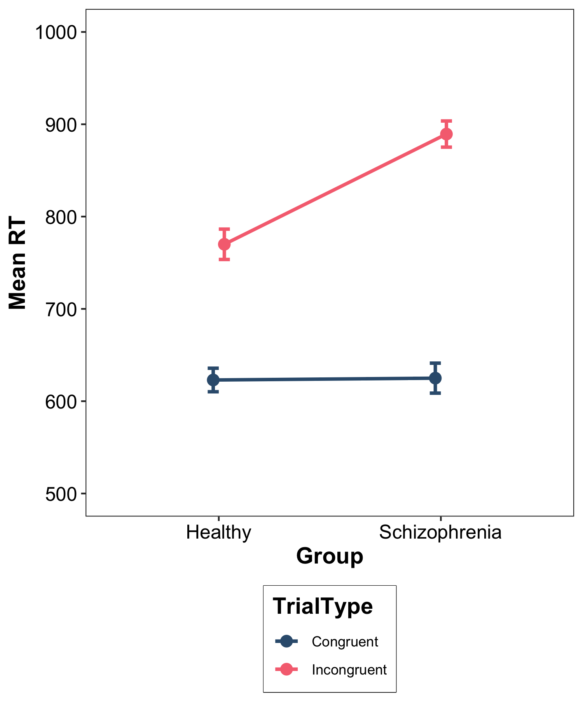
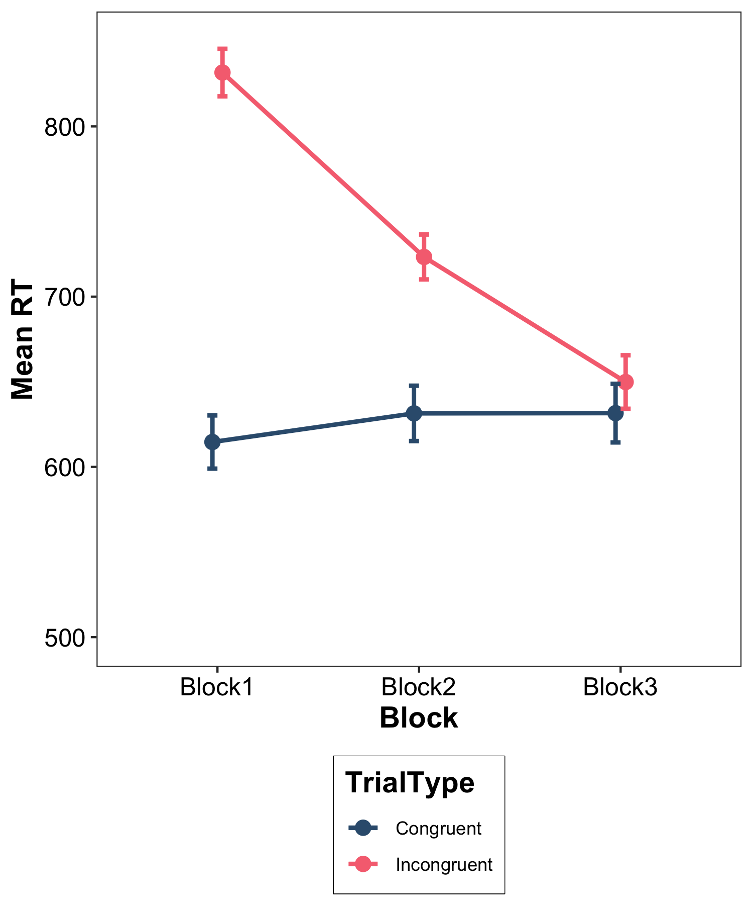

Last week's lab encouraged you to work with various sources of information in building a first small experiment in PsychoPy.  It was good to see that some of you enjoyed the sense of achievement when you got something going.  The purpose of the task was to facilitate an experience where you are pretty much journeying into the unknown, taking risks, having a go and realising that a) you cannot break the toys and b) large gains in psychological findings and truths are often made by someone starting in exactly the way you did - piecing together an experiment, often with a manual by your side.

This week, we look at the output of an experiment - the raw data - in all its messiness. Until now, you have been provided with extremely clean and tidy datasets.  This won't be the case when working with raw data fresh from an experiment.  The lecture introduces some concepts and practice for processing raw data to begin to turn it into something that could be analysed.

For statistical methods, we continue with two-factor ANOVA but this week focus on mixed and within-participant study designs.

When you go to the lecture for the statistics content,  you will see that this content has previously occupied the week 8 space of a statistics module.  You will also see this on the slides.  This is not an important consideration.  The learning content is good for week 7 of this module for this year.


# Lecture

Watch Lecture 1 [here](https://lancaster.cloud.panopto.eu/Panopto/Pages/Viewer.aspx?id=a884e412-edf5-495e-93de-b4fd010a9550&start=0)

Download Lecture 1 slides [here](data/Wk7/5141 Week 7 Lecture 1 Processing RT Data Slides Student.pptx)

Watch Lecture 2 Part 1 [here](https://lancaster.cloud.panopto.eu/Panopto/Pages/Viewer.aspx?id=9e17c9b2-c9d3-4394-b464-af580082a11d)

Watch Lecture 2 Part 2 [here](https://lancaster.cloud.panopto.eu/Panopto/Pages/Viewer.aspx?id=dfa633a4-19fe-4ee7-b465-af580082b47e)

Watch Lecture 2 Part 3 [here](https://lancaster.cloud.panopto.eu/Panopto/Pages/Viewer.aspx?id=d6775197-6715-4487-a524-af5800854a60)

Download the lecture slides [here](data/Wk7/Two-Factor Mixed and Within-Participants ANOVA HANDOUT Updated.pdf), and [here](data/Wk7/Two-Factor Mixed and Within-Participants ANOVA Updated.pdf) for a larger version.

# This Week's Lab

Part 1: As described in the lecture, we will work with a small set of files from three participants who have completed the VPT task from week 5. Raw files from PsychoPy will be uploaded to R and we will work with code and data to tidy, clean and check the data so that we are almost ready to analyse. You may learn what I have observed to be true here: working with data is 4/5 preparation and 1/5 analysis!

Part 2: Around the turn of the hour, turn back to the statistics and follow the code to apply the concepts and practical steps demonstrated by Mark in the lecture for mixed and within-participant ANOVA analysis methods.

A challenge for the brave and courageous: having executed a within-participant two-factor ANOVA with Mark's data, can you adapt the code and execute a two-factor within-participant ANOVA for the Wang et al., 2019 dataset? Look to the end of the script for details on how to get going if you are up for this.

## Learning Objectives

By the end of the lab you should be able to: 

- Upload multiple datafiles simultaneously and create one dataframe.
- Tidy a dataframe by removing unneeded colmns and blank rows.
- Process raw data to be able to perform a speed-accuracy trade off check.
- Check that your participants' accuracy response rates are above chance level.
- Perform a mixed and within-participant ANOVA to establish whether either of the two main effects or interaction are significant
- Understand when to perform a simple main effects analysis
- Perform a simple main effects analysis
- Report the results in a results section standard paragraph for a factorial ANOVA

**Note: We will only be providing code for new commands that you have not previously done. From now on, you will be generating your own code for a large portion of the lab exercises. So, it would be a good idea to have the lab class materials from previous weeks readily accessible to remind you how to accomplish different tasks.**

**There are hints in the webpage main body text - please take time to read this and make sense of it to help you as you use earlier code as a model for your new code; we have put 'check your answer' boxes throughout and the staff can also assist**

```{r setup, include=FALSE}
knitr::opts_chunk$set(echo = TRUE)
```

Once you are logged into the server, create a folder for today's session. Navigate to the bottom right panel and under the `Files` option select the `New Folder` option. Name the new folder `psyc5141_lab_7`. **Please ensure that you spell this correctly**.

Click `File` on the top ribbon and select `New project`. Next, select existing directory and name the working directory `~/psyc5141_lab_7` before selecting `create project`. Make sure you open this project if R does not do it automatically.  When working in a project, your working directory is automatically set for you.

Finally, open a script for executing today's coding exercises. Navigate to the top left pane of RStudio, select `File` -> `New File` -> `R Script`. If you want to work with a .rmd (R Markdown) script, please do so. Working from a script will make it easier to edit your code and you will be able to save your work for a later date.

Now that you have created a folder for today's session, it’s time to add the Week 7 files to this new folder: 

Download the datafile `VPT_data_raw.zip` for part 1 lab activities [here](data/Wk7/VPT_data_raw.zip).

Download the datafile `psyc5141_Week7.zip` for part 2 lab activities [here](data/Wk7/psyc5141_Week7.zip).

Before moving on, let's load the relevant libraries/functions that we will be using in today's session.

```{r, message = FALSE, eval=FALSE}
library("tidyverse")  # For data storage and manipulation
library("tidyr")      # For tidy data
library(moments)
library(effects)
library("rstatix")    # For descriptives statistics, outlier detection, running the ANOVAs etc.
source("simple.R")    # Custom function for generating the simple main effects

#turn off scientific notation for large / small numbers
# Disable scientific notation globally
options(scipen = 999)
```

```{r, echo = FALSE, message=FALSE}
library("tidyverse")  # For data storage and manipulation
library("tidyr")      # For tidy data
library(moments)
library(effects)
library("rstatix")    # For descriptives statistics, outlier detection, running the ANOVAs etc.
source("data/Wk7/simple.R")    # Custom function for generating the simple main effects

#turn off scientific notation for large / small numbers
# Disable scientific notation globally
options(scipen = 999)
```

**Note that the custom function `simple.R` that we use to calculate the simple main effects must be present in your directory whenever you seek to use it.**

## Part 1: Processing Raw Data Files

The code below takes you from the raw files that come down from PsychoPy, and after uploading them into R, begins to prepare the data ready for an analysis, following the concepts and advised practice from Lecture 1.

### Getting multiple files into R at the same time

#### Step 1

Upload the `VPT_data_raw.zip` file into this week's folder on R, where R should automatically unzip it for you. If you are working inside a project, then the working directory is automatically set to this folder.

The first line of code in this chunk creates an object called 'folder path'. We attach the name of our `VPT_data_raw` folder to the folder path object.  Essentially, by doing this, the second line of code will work time and time again, just by attaching a different folder name to folder path each time.

When we run the second line of code, R creates a list of .csv files that it finds inside the folder, listing them with their complete names. As the experimenter, it is likely you will know how many files you have, so this enables an early check that you have the correct number of files.

```{r}

# Set the folder path containing your CSV files
# Replace with your actual folder path
# If the VPT data raw folder is in your working directory, you only need the name of the folder so comment out this line and uncomment the following line as that will work for you.
folder_path <- "data/Wk7/VPT_data_raw"

# folder_path <- "VPT_data_raw"

# List all CSV files in the folder
csv_files <- list.files(path = folder_path, pattern = "\\.csv$", full.names = TRUE)

# check the list of filenames that R can see inside the folder
csv_files

```

We have three files, which is correct.

#### Step 2

The next code reads each separate .csv file and maps them into a dataframe. At the same time, it recognises that the files have unique names and creates a participant ID from the index of each file. This means that file ending `666` is the first file in the list and so the code assigns `PartID = 1` to the rows of data that comes from this file and so on. You now have a Participant ID variable.

Note how I have been careful to record the search prompt that I used, and cited the source of this chunk of code.  I have done this to show you a) that knowing how to search is as important as knowing how to code for these types of code snippets and b) recording your successful prompt and the location of the source is ethical practice - it is akin to citing a study.

```{r message = FALSE}
# search prompt "import multiple csv into Rstudio and combine them adding a column for file name"
# Source - https://stackoverflow.com/a/61511379
# Posted by derelict, modified by community. See post 'Timeline' for change history
# Retrieved 2026-11-07, License - CC BY-SA 4.0

# specify the directory, then read a list of files
# return a single data frame w/ purrr:map_dfr 
data_all = csv_files %>% 
    purrr::map_dfr(read_csv, .id = "PartID") # make a column for participant ID
```

We can now see a dataframe in our environment called `data_all`. This is the most raw form of the data.  It originates from three files, each coming from one participant.

```{r}
dim(data_all)
```

Raw data from three participants is showing as 666 rows and 125 columns.  We now have a dataset in R that we can begin to tidy.

Before we go any further, view the dataset to see just how messy it is.  Can you see the columns that are of interest to us? Think back to the VPT task talked about in the lecture and that you took part in on PsychoPy. What were the important variables in the experiment?  Which columns correspond to those variables?  And which columns are our dependent variables?

```{r}
view(data_all)
```

::: {.callout-warning icon="false" collapse="true"}
## Answer

 - PartID. 
 - PerspCueText. 
 - Consistency. 
 - resp.corr. 
 - resp.rt. 
 
are the important columns that correspond to our variables.

:::

How does R see the PerspCueText variable at the moment?  Check using this code:

```{r}
class(data_all$PerspCueText)
```

Hopefully by now, your response to this is - "this needs to be a factor".  You would be correct, however we do not need to worry about this at this point.  We can do this later.  But it is good to inspect what class R sees for the variables when you first upload your data.

Scan across the 125 columns in the dataset.  There are many many blank cells.  This is because PsychoPy has stacked the trials so that practice trials are earlier in the dataset columns than test trials.  When the test trials take over, there is no data for the practice trial rows and so they are left blank.  This is good as it can help us filter them out.

There are also a lot of columns that PsychoPy generates which are internal checks, logs of internal processes. These are good for debugging however are not necessary for analysis.  These will be removed at some point in our tidying process.  This is why we call raw data "untidy' data.  So let's get tidy and clean!

### Tidying the raw data

#### Step 1: Remove practice trials and check if participants have understood the task

The practice trials are in this dataset which we do not want to include in the main analysis.  We do want to inspect them to check that the participants understood the instructions and so their trial data could reasonably be expected to be valid. We need to filter out the practice trials.  

How do we separate them though?  There are four columns that look very alike:

 - respp.corr
 - respp.rt
 - resp.corr
 - resp.rt
 
The single difference here is that the top two column names have an additional p in their spelling.  This extra 'p' denotes that these are the columns for accuracy and RT data for the practice trials

We can look at how many values there are for the accuracy column with this command:

```{r}

table(data_all$respp.corr)

```

In total, 45 values; lets look at the RT column for practice trials:

```{r}

table(data_all$respp.rt)

```

OK, not a great way to inspect 45 values.  Since they are all unique values, the table function lists them all, which isn't helpful for us to know that they are all from the practice trials.

Since we know that there are only 0 and 1 in the accuracy column, we could use this column to filter out the practice trials into a smaller dataset. The code below asks R to filter out practice trials that have a response of either equal to or smaller than 1, thus capturing our 1s and 0s in these rows.

```{r}

# make a small data set of practice trials
Practice_data <- data_all %>% 
  filter(respp.corr <= 1)

```

This gives us 45 observations in a new dataframe called `Practice_data`.

Do a check to look at whether you can confidently say that the participants understood the instructions. Believe it or not, you already have the code to do this - it is like one of the descriptive statistics code chunks you have used before. 

-   For each participant, count the number of correct responses and incorrect responses across the fifteen trials

-   You could also calculate the percentage correct for each participant

-   If you have a lot of participants you could plot the accuracy rates, using `facet_grid` function - with a little thinking, you can also adapt the code you have to do this.  We don't need to do it here as we have only three participants.

-   Alternatively, If you have set a base rate for accuracy, you could filter out the participants who score below to see a) how many and b) which participants they are and do a check for successful understanding of the instructions this way.

::: {.callout-warning icon="false" collapse="false"}
## Question

What was an advised accuracy rate for concern around the validity of accuracy responses from the lecture? Think back to the second section where we talked about impish participants who where behaving badly for our data...

:::

::: {.callout-warning icon="false" collapse="true"}
## Answer

In the lecture, we talked about two-response tasks having a warning threshold of 50% accuracy as an early indicator that a participant may have been randomly pressing response keys. You could use this as a starting base rate for concern around bad data from participants.

:::


Today, we will just calculate an average percentage correct for each participant:

```{r}
# Combine the trials for each person in each condition
Practice_check <- Practice_data %>%
  # Create separate participant-condition groups
  group_by(PartID) %>% # be sure to get the respp.corr variable and not the resp.corr variable here
  summarise(
    # Proportion correct × 100 = percentage correct
    Accuracy = mean(respp.corr) * 100, 
    # Return an ordinary, ungrouped dataframe
    .groups = "drop"                
  )

# Inspect the resulting participant-level accuracy and Rt scores
head(Practice_check)
```

Because there are only three participants here, we can simply call the `head()` function. On the first look, accuracy rates across the practice trials look high; each participant seems to have at least understood the instructions and are above 50% accuracy. 

You would want to set an exclusion criterion to filter out a participant who gets less than a certain level of practice trials incorrect before you begin collecting data. This is especially important if you are running your experiment online and cannot observe a participant's behaviour during the data collection session.

So we have done a check, however the practice trials are still in our `data_all` dataset.  For completeness, you will want to remove the practice trials from the larger dataset. For this, we need to use a different key. As seen above, we have dependent variables specfic to our test trials in `resp.corr` and `resp.rt`. Let's have a look at `resp.rt`:

```{r}
summary(data_all$resp.rt)
```

We can see that there are 66 NA values. This is an additional 21 rows to the blank rows that make up the practice trials. If you look in the `data_all` dataframe, there are some blank rows as well as the practice trial rows - all of which contribute to the NAs. Lets see what happens if we remove these NAs.  

The code below asks R to make a new dataframe that does not contain any cells that have NA values in the `resp.rt` column, and keep all 125 columns.

Notice here how I am creating a new dataframe `data_rt_clean`. I am leaving my `data_all` dataframe intact, in case I make a mistake and need to start again, I will always have it in my environment.

```{r}
data_rt_clean <- data_all[!is.na(data_all$resp.rt), ]

summary(data_rt_clean$resp.rt)

dim(data_rt_clean)

```

We looked at a summary of the `resp.rt` variable in the new dataset and can see that the NA values have been filtered out - they are no longer listed in the summary. Also, by calling `dim`, we can see that 66 rows have disappeared, and now we have 600 rows for three participants. We still have 125 columns. We have removed the practice trials and the blank rows, but not the unneeded columns.

#### Step 2 Checking the number of trials per participant / condition

Before we do any more tidying, it is good to check that trials have been recorded properly.  

We had four blocks each with 50 trials per participant, which equals 200 trials overall per participant. So far, the maths is good. But we can do a further check and count the number of trials per participant:

```{r}
table(data_rt_clean$PartID)
```

This code has counted the number of rows for each participant. We look good.

We can also count for number of trials per participant per Consistency:

```{r}
table(data_rt_clean$PartID, data_rt_clean$Consistency)
```

This tells us that there are some filler trials that we also need to remove!

and a check for per participant per Perspective

```{r}
table(data_rt_clean$PartID, data_rt_clean$PerspCueText)
```

So each participant seems to have the same number of trials per condition. This is a good result for our checks so far.

Lets have a look at our dependent variables: `resp.corr` and `resp.rt`

```{r}
summary(data_rt_clean$resp.corr)
```

There are no strange values here and no NA values. Good. We did already check RT but we can do it here again for completeness

```{r}
summary(data_rt_clean$resp.rt)
```

#### Step 3 Making the dataset more manageable by removing unneeded columns

After this cursory check, we can proceed to removing unneeded columns. This makes management of the dataframe much easier. As the experimenter you will have a good understanding of what columns are important for reporting. Here, we can select the first 20 columns - from `PartID` to `resp.rt`. We use `glimpse` to have a look at the smaller dataset.  Notice here I am making a further new dataset.  The `data_red` here is short for `data_reduced`.

```{r}
data_red <- data_rt_clean %>%
  select(PartID:resp.rt)

glimpse(data_red)
```

Within the first 20 columns, there are four columns that are full of NA values. Look at the names of the columns.  They all have a double 'pp' before the period. This tells us that they are associated with the practice trials and so are of no further use to us as we have removed the practice trials earlier. We could clean this out further:

```{r}
data_red <- data_red %>% 
  select(-respp.keys, -respp.duration, -respp.corr, -respp.rt)

glimpse(data_red)
```

All those red NA values have gone.

```{r}
dim(data_red)
```

We now have 600 rows and a much more relevant and manageable 16 columns.

#### Step 4: Transformations of critical variables

Remember that PsychoPy stores RT in seconds, and for analysis it needs to be in milliseconds for precision. We can do this *transformation* now: To do this we take our `resp.rt` varialbe and multiply it by 1000. Notice how I am creating a new variable `data_red$rt`.  I am leaving my raw `resp.rt` variable intact - again, in case I make a mistake and need to use it once more.

```{r}
data_red$rt <- data_red$resp.rt*1000
summary(data_red$rt)
```

The summary of the new `rt` variable shows that the fastest response across all three participants is 318 ms and the slowest is 1607.2 ms.  This is where you can also check if you have any observations that are impossibly fast.  As described in the lecture, those would be observations of lower than 150ms.

::: {.callout-warning icon="false" collapse="false"}
## Thinking about processes and associated code

This is an opportunity to imagine / visualise the code you would use if you did need to remove trials.  Imagine the Min value here showed a mimimum time of 120.7.  What function could you use to remove those trials and what number would you use to remove them to meet the desiderata that there were no trials faster than 150ms?

:::

::: {.callout-warning icon="false" collapse="true"}
## Possible Answer

You could use the `filter` function and set it to remove `resp.rt` observations that were smaller than 150ms (< 150).

If you used smaller than 120.7 ms, you would only remove trials faster than 120.7 ms when the lecture advised that 150 ms was the lower threshold for responses that meant the participant could have consciously processed the stimuli, and so the time reflects the cognitive process in which we are interested and not a random button press.

:::


Here is where we can convert our independent variables into factors: Here I adapt code from week 3 lab:

We need `PartID`, `PerspCueText` and `Consistency`

```{r}
# order is not important here so we do not have to use the levels argument
data_red$PartID <- as.factor(
  data_red$PartID)
levels(data_red$PartID)

# order is not important here so we do not have to use the levels argument
data_red$PerspCueText <- factor(
  data_red$PerspCueText
)

data_red$Consistency <- factor(
  data_red$Consistency
)

```

Ooh - look at the `Consistency` factor, it still has the `filler` trials. We are only interested in the `consistent` and `inconsistent` trials, so we need to filter out the `filler` level trials

```{r}
data_red <- data_red %>% 
  filter(!Consistency == "filler")

data_red$Consistency <- droplevels(data_red$Consistency)
  
```

You should now only see two levels in the Consistency variable:

```{r}
levels(data_red$Consistency)
```

and look earlier - there were 8 filler trials per participant, which means 24 in total. Our new number of rows = 576 which is 24 less than the 600 rows we had before. We are good.

##### Step 5: Check for the correct number of trials per participant per condition

And if you now count the number of observations per participant it should show 4 blocks of 48 trials each = 192 per participant

```{r}
table(data_red$PartID)
```

And so it does!  We can check that the 192 trials is in fact due to four blocks of 48 trials by chaining our conditions with participant ID in the table function as below:

```{r}
table(data_red$PartID, data_red$PerspCueText, data_red$Consistency)
```

As in the lecture, by tabulating be each participant, across conditions, we can see that each participant has the correct number of trials in each block = 48.

### Generating some mean values for a speed-accuracy tradeoff check

#### Step 1 Generate average accuracy for participants across the conditions

We are at the stage where we can generate averages per participant, per condition for both `rt` and `accuracy rate`. With these we can look for a speed-accuracy trade off as a check for the validity of our data. I have adapted the following code from lab 3 here to fit our purpose.

We group by three variables: `PartID`, `PerspCueText`, and `Consistency`

```{r}
# Combine the trials for each person in each condition
data_red_means <- data_red %>%
  # Create separate participant-condition groups
  group_by(PartID, PerspCueText, Consistency) %>% 
  summarise(
    # Proportion correct × 100 = percentage correct
    Accuracy = mean(resp.corr) * 100, 
    RT = mean(rt),
    # Return an ordinary, ungrouped dataframe
    .groups = "drop"                
  )

# Inspect the resulting participant-level accuracy and Rt scores
head(data_red_means)

```
#### Step 2: Perform and plot correlation between Accuracy and RT

We can now perform and plot a correlation between Accuracy and RT to see if we have a speed-accuracy trade off in our data. Remember from the lecture, the positive correlation showed the speed-accuracy trade off effect, where high accuracy was linked to slow trials, i.e large values of RT and low accuracy was linked to small RT values, i.e. fast trials. Even though we only have three participants, we have 12 values - one for each block from each participant, so we should be able to see a relationship. In the code, we ask for the line of best fit to be plotted (the geom smooth function) to help us see the relationship.

```{r}

# Basic scatter plot with regression line
ggplot(data_red_means, aes(x = RT, y = Accuracy)) +
 geom_point(color = "blue", size = 3) +
 geom_smooth(method = "lm", se = FALSE, color = "red") +
 labs(title = "Speed Accuracy Trade Off Check",
      x = "RT (ms)",
      y = "Accuracy Rate") +
 theme_minimal()
```

Even with our very small dataset, we can see the correlation is negative - and so we do not appear to have a speed-accuracy tradeoff (SAT).

### Checking that participant data is signal and not noise

#### The Binomial Test

First lets look at the coin-toss example from the lecture:

In a set of 50-coin tosses, where an unbiased coin would give us 25 head and 25 tail outcomes, we get 32 heads (or successes). What is the probability that we would get this result by chance if the coin is unbiased. For this we can run a binomial test. To run a binomial test, we need:

 - the number of successes (here - x = 32), 
 - the total number of trials (here - n = 50) 
 - and the probability that heads would occur if the coin was unbiased (here - p or p_null = 50% or 0.5).

```{r}

# binomial(x, n, p)

binom.test(32, 50, 0.5, alternative = "two.sided")

```

This gives us a probability of getting 32 successes out of 50 trials.  But we need to go a step further, because what we actually need is the *cumulative probability*. The code for this is below:

```{r}

# Binomial test and cumulative probability in R

# Parameters
successes <- 32      # Number of successes observed
trials <- 50         # Number of trials
prob_success <- 0.5  # Probability of success per trial

# # 1. Run a binomial test
# test_result <- binom.test(successes, trials, p = prob_success)
# 
# # Display the binomial test result
# print(test_result)
# 
# # 2. Calculate cumulative probability:
# #    P(X <= successes) for X ~ Binomial(trials, prob_success)
# cum_prob <- pbinom(successes, size = trials, prob = prob_success)
# 
# cat("Cumulative probability P(X <= ", successes, ") =", cum_prob, "\n")

# 3. Calculate upper tail probability:
#    P(X >= successes) = 1 - P(X < successes)
upper_tail_prob <- 1 - pbinom(successes - 1, size = trials, prob = prob_success)

cat("Upper tail probability P(X >= ", successes, ") =", upper_tail_prob, "\n")


```

The cumulative probability of getting equal to or more than 32 heads is *p* = .032. In the example of the coin-toss, we have a biased coin as it keeps giving heads responses at a surprising rate!

Lets apply this to the VPT experiment data now. Participants could be randomly pressing across the entire experiment or just within one block. If a participant decides to sabotage their responses at the smallest level, it probably means we should discard all their trials. So we should test for random button pressing behaviour at the block level to be safe and sound.

So what do values do we need for our binomial test:

 - number of trials - here it is per block, so 48
 - rate of success - we have two buttons to press, so there is a 50% chance of success on each trial
 - number of successes - we need to count the number of accurate trials within each block for each participant.

First we need to group responses for each participant at each condition level. Then we need to count the number of success trials at each condition level. These are our number of successes per participant per condition.  We can store this count of successes in a column and feed this column into our binomial test. Then we can calculate our cumulative probability for each participant at each condition.

```{r}

# Combine the trials for each person in each condition
data_red_count <- data_red %>%
  # Create separate participant-condition groups
  group_by(PartID, PerspCueText, Consistency) %>% 
  summarise(
    # Proportion correct × 100 = percentage correct
    Success = sum(resp.corr), 
    # Return an ordinary, ungrouped dataframe
    .groups = "drop"                
  )

# Inspect the resulting participant-level accuracy and Rt scores
head(data_red_count)
```
In the code below, I store all the necessary values in the dataframe, and then I run the cumulative probabilty test using the binomial data by calling those column names from the dataframe.

```{r}

# Number of successes (correct trials)
x <- data_red_count$Success

# Total number of trials
data_red_count$n <- 48

# Hypothesized probability of success
data_red_count$p_null <- 0.5

# Run a two-sided exact binomial test
result <- pbinom(data_red_count$Success, data_red_count$n, data_red_count$p_null)

# 3. Calculate upper tail probability and add the result per condition per participant to the data_red_count dataframe
#    P(X >= successes) = 1 - P(X < successes)
data_red_count$upper_tail_prob <- 1 - pbinom(x - 1, size = data_red_count$n, prob = data_red_count$p_null)

# print the values of the cumulative probability
data_red_count$upper_tail_prob

```

Wow - look at those incredibly small probabilities! This is a hypothesis test - we hypothesised that participants were acting randomly over a block of 48 trials, at chance level, we could expect 24 yes / consistent responses and 24 non / consistent responses. If the hypothesis was true then our probabilities here would not be so small. They would be above our critical p value of .05.

We can print out the numbers like this because we only have a small number of participants. But you cannot really do this visual inspection if you have lots of participants - your brain would not be able to reliably process so many digits for each number. So we can ask R to filter out any of the cumulative probabilities that are larger than .05 to get a set of participant conditions that may be full of noisy, random datapoints

```{r}

noisy_ps <-data_red_count %>%
  select(PartID, upper_tail_prob) %>%
  filter(upper_tail_prob > 0.05)
```

If you look at the dataframe `noisy_ps`, for this data, there are no conditions for any participants that meet this criterion and so we have well behaved participants, none of which need to be excluded.

### Separating out the 'Yes" trials

This is related to the decision tree in the lecture, where on slide 65, it says "separate Yes responses" - in this dataset, 'Yes' responses are coded in the `Consistency` column - they are the consistent trials. Which means we need to make a new dataset that contains only the consistent trials. Remember that our last dataset was the `data_red` dataset, where we had gotten rid of filler trials to leave us with 576 rows. This is the data we call here to filter out consistent trials

```{r}
data_consistent <- data_red %>% 
  filter(Consistency == "consistent")

dim(data_consistent)
```

Our number of rows has been reduced from 576 to 288. 288 is half of 576 which we would expect from a two-response choice task. We can also check that only consistent trials are in the consistency column:

```{r}
table(data_consistent$Consistency)
```

This confirms that our code has worked as we expected it to. Note here that in this new dataset, R still sees the factor `Consistency` as having two levels. There are ways to drop the redundant level (code is used above) but it is not important for our processes here at the moment.

The `data_consistent` dataset is the dataset on which you would perform an error analysis as it still has correct and incorrect trials in the `resp.corr` column.

```{r}
table(data_consistent$resp.corr)
```

Although there are only two errors! It might be useful to rename the dataset to reflect this, as there are a number of datasets in our environments at this point.

```{r}
data_error_analysis <- data_consistent
```

To perform an RT analysis, however, we need to remove incorrect trials from the `data_error_analysis` dataset. We can name this new, smaller dataset with a helpful label also. We saw above that there were only 2 incorrect trials in the dataset and so our RT analysis ready dataset should have 288-2 rows once we run the code to remove incorrect trials

The code below tells R to make a new dataset `data_rt_analysis` that only contains `resp.corr` observations of '1' - i.e. only trials that were answered correctly.

```{r}
data_rt_analysis <- data_error_analysis %>% 
  filter(resp.corr == 1)

dim(data_rt_analysis)
```

This is correct.

We can now have a look a the distribution of our RT data, using the `rt_analysis` dataset. Remember from the lecture, we should expect to see a positively skewed distribution - that is more values in the higher, positive values than lower or negative values. So, a longer tail towards the right-hand side of a graph. Note for the wise, if we do see any negative values on this graph, those datapoints are invalid as we cannot logically have negative time. I include negative in the definition here as you will encounter datasets that show a positive skew and do include valid, negative values.

To draw a distribution, we can use a histogram or a density curve - I'll show you both here:

```{r message = "FALSE"}
# histogram first

ggplot(data_rt_analysis, aes(x = rt)) +
 geom_histogram(fill = "#3a86d4", alpha = 0.7) +
 labs(title = "Histogram for RT Distribution",
      x = "RT (ms)", 
      y = "Count") +
 theme_minimal()
```

```{r, message = "FALSE"}
# Density curve with mean rt line

ggplot(data_rt_analysis, aes(x = rt)) +
 geom_density(fill = "lightblue", alpha = 0.6) +
 geom_vline(aes(xintercept = mean(rt)),
            color = "red", linetype = "dashed", linewidth = 1) +
 labs(title = "Density Curve for RT Distribution with Mean RT Line",
      x = "RT (ms)",
      y = "Density") +
 theme_minimal()
```

```{r}
# Density curve with mean rt and median rt line

ggplot(data_rt_analysis, aes(x = rt)) +
 geom_density(fill = "lightblue", alpha = 0.6) +
 geom_vline(aes(xintercept = mean(rt)),
            color = "red", linetype = "dashed", linewidth = 1) +
  geom_vline(aes(xintercept = median(rt)),
            color = "blue", linetype = "dashed", linewidth = 1) +
 labs(title = "Density Curve with Mean and Median Line",
      x = "RT (ms)",
      y = "Density") +
 theme_minimal()
```

What does adding the median line do for us? If you remember back to your first year stats learning, one check of whether you have a normally distributed set of values is that the median average value and the mean average value are the same. So on this second density curve, not only do we have the curve itself showing a skewed distribution, but the median and mean value lines are also distinct from each other. A further confirmation that our RT distribution follows a non-normal distribution. The longer tail to the right hand side of the curve tells us there are some positive values that are far away from the centre of the distribution, hence the skew is positive in nature.

This final plot gives a visualisation of the histogram - which gives a visual representation of number of data points at each grouping, and overlays the density plot that helps see the skew as a smooth line. Perhaps more importantly, combining the two lets you see the skew *and* that as you go into the tail of the distribution, there are gaps in the values - so not in fact *smooth* but discontinuous - a feature that you do not see if you only use the density curve.  Using both is informative.

```{r message = FALSE}

# Histogram with kernel density
# note that we have changed the y axis from count in the histogram
# to density here, to have both the histogram and density curve
# plotted to the same scale

ggplot(data_rt_analysis, aes(x = rt, y = after_stat(density))) + 
  geom_histogram(fill = "#3a86d4", alpha = 0.7) +
 labs(title = "Histogram with Density Curve with Mean and Median Line",
      x = "RT (ms)",
      y = "Density") +
 theme_minimal() +
  geom_density(colour = "red", alpha = 1) +
  geom_vline(aes(xintercept = mean(rt)),
            color = "red", linetype = "dashed", linewidth = 1) +
  geom_vline(aes(xintercept = median(rt)),
            color = "blue", linetype = "dashed", linewidth = 1)
 

```

That's it for now. In week 8 lab, you will need to rerun this part of the code in order to continue looking at the RT distribution :)

Now onto Part 2 of the lab.


# Part 2: Analysing hypothetical data for the mixed-design Stroop experiment

Because there are a lot of processes in this section for which you have met code before, this is where we begin to ask you to think about what the code would be.

We begin by analysing the mixed-design Stroop experiment described in the lecture. Recall that in this experiment, a researcher wants to test the hypothesis that response inhibition---the ability to suppress task-irrelevant information---is impaired in patients with schizophrenia. She predicts that if this is true, then a group of patients with schizophrenia will show a larger Stroop effect than a group of healthy controls. Our researcher administers a multi-trial Stroop task to two groups of participants in a 2 (group: healthy *vs.* schizophrenia) $\times$ 2 (trial type: congruent *vs.* incongruent) mixed design, where group is a between-participants factor and trial type is a within-participants factor.

The data set contains four columns:

* **Participant:** represents the participant number, which ranges from 1--80, with $N$ = 40 participants in each of the four conditions resulting from the combination of our two factors.

* **Group:** represents whether the participant belongs to the healthy control group (Healthy) or the schizophrenia group (Schizophrenia).

* **Congruent:** represents the mean response time, averaged across trials, for congruent trials in which the colour word and the ink it is presented in are the same.

* **Incongruent:** represents the mean response time, averaged across trials, for incongruent trials in which the colour word and the ink it is presented in are different.

### Import data, set variables as factors, generate descriptive statistics, and perform assumption checks

The first thing you need to do is load the data into RStudio. Make sure that you name your data frame as `stroopMixed`.

```{r, echo = FALSE, message = FALSE}
# Import data
stroopMixed = read_csv("data/Wk7/StroopMixed.csv")
(stroopMixed)
```

::: {.callout-warning icon="false" collapse="true"}
## Answer

```{r, echo = TRUE, message = FALSE, eval=FALSE}
# Import data
stroopMixed = read_csv("StroopMixed.csv")
(stroopMixed)
```
:::

The next thing we need to do is convert the `Participant` variable into a factor. We can do this with the following code:

```{r}
# Convert "Participant into factor
stroopMixed$Participant = factor(stroopMixed$Participant)
```

Once you have done this, you need to convert the `Group` variable into a factor. We'll let you do this yourself using your own code:

::: {.callout-warning icon="false" collapse="true"}
## Answer

```{r, echo = TRUE, message = FALSE}
# Convert "Group" into factor
stroopMixed$Group = factor(stroopMixed$Group, levels = c("Healthy","Schizophrenia"))
```
:::

The next thing we need to do is convert our data from wide format into long format. We discussed the distinction between these two formats in the Week 4 lab session and we covered it again in our Week 5 lab session. In brief, we need to create a new variable called `TrialType` that contains the different levels of this factor, congruent and incongruent, which are currently located in different columns. We can do this using the following piece of code which users the `gather()` function encountered previously:

```{r, message = FALSE}
# Convert data into long format
stroopMixedLong = gather(stroopMixed,
                         TrialType,
                         RT,
                         Congruent:Incongruent,
                         factor_key = TRUE)
```

Let's unpack what this is doing. The first argument to `gather()`, `stroopMixed`, is the name of our current data set in wide format. The second argument tells R we want a new column called `TrialType`. The third argument, `RT`, tells R the name of our dependent variable. The fourth argument tells R to take the columns `Congruent` through to `Incongruent` and combine them into a column labelled `TrialType` (our second argument). The final argument, `factor_key = TRUE`, tells R that we want this new column to be a factor. The results of this transformation are allocated to a new data frame called `stroopMixedLong`. This contains our data in long format and we will be using this version of the data set from henceforth.

Next, we will generate some descriptive statistics (mean, standard deviation, and confidence intervals). You did this for a between-participants factorial design in last week's seminar, so you can once again generate the code for this yourself.

::: {.callout-warning icon="false" collapse="true"}
## Answer

```{r, echo = TRUE, message = FALSE}
# Get descriptive statistics
mixedDescriptives = stroopMixedLong %>%
  # Organise the output by the "Group" and "TrialType" factors
  group_by(Group, TrialType) %>%
  # Request means, standard deviations, and confidence intervals
  get_summary_stats(RT, show = c("mean","sd","ci"))
  # Print the results
  print.data.frame(mixedDescriptives)  
```
:::

If you have executed the code correctly, then you should see the following output:

```{r, echo=FALSE}
print.data.frame(mixedDescriptives)
```

At this stage, we would ordinarily perform various checks including identifying possible outliers and checking that our data satisfy the normality assumption. We won't perform those checks today, not because they are not important (they most certainly are!), but rather because we don't have the time to do so. There is one check that we will perform and that is to see if the homogeneity of variance assumption has been violated. In a mixed design like ours, the homogeneity of variance assumption only applies to the between-participants factors, but not the within-participants factors.

Our between-participants factor is `Group` (healthy vs. schizophrenia) but remember that each group receives each level of our within-participants factor `TrialType` (congruent vs. incongruent). So, we need to test whether the variances are equal or not for the healthy and schizophrenia groups for congruent and incongruent trials separately. The following code will generate what we need:

```{r, message = FALSE, warning = FALSE}
stroopMixedLong %>%
  # Organise the output by the "TrialType" factor
  group_by(TrialType) %>%
  # Generate Levene's test on the "Group" factor
  levene_test(RT ~ Group)
```

Levene's test is non-significant for congruent trials, *p* = .051 (although notice that it is only marginally short of significance), and also for incongruent trials, *p* = .390. So, we can safely assume that the homogeneity of variance assumption has been satisfied.

### Running the mixed ANOVA

To run our ANOVA, we are going to use the `anova_test` function from the `rstatix` package. **This is the function that I recommend you use for mixed or fully-within participants factorial designs.** The code required to run the ANOVA is given below:

```{r, message = FALSE, warning = FALSE}
# Create the mixed design ANOVA model
stroopMixedModel = anova_test(data = stroopMixedLong, 
                              dv = RT, 
                              wid = Participant, 
                              between = Group, 
                              within = TrialType, 
                              detailed = TRUE)
# Print the model summary
(stroopMixedModel)
```

To create the model, the first argument we supplied to `anova_test` was the name of our data, `stroopMixedLong`. The second argument we supplied was our dependent variable, `RT`. The third argument we supplied was `Participant`, which is the column containing the individuals/participants identifier. The fourth argument we supplied was our between-participants factor, `Group`. The fourth argument we supplied was our within-participants factor, `TrialType`.

Notice that the resulting ANOVA table is different in format to those given in the lecture. The format given in the lecture follows a standard convention, but `anova_test` frustratingly uses a different format. The main effects of `Group`, `TrialType`, and the `Group:TrialType` interaction are each given on separate rows. The row corresponding to each effect contain the between-group degrees of freedom (DFn), the error degrees of freedom (DFd), the between-group sums of squares (SSn), the error sums of squares (SSd), the $F$ ratio (F), and the *p* (p) value. On the bright side, this organisation makes it easier to locate the correct degrees of freedom when reporting the different outcomes.

Looking at our ANOVA table, we can see that there is a significant main effect Group, *p* $<$ .001. Inspecting our descriptive statistics, we can see that this arose because mean response times are longer for the schizophrenia group than the healthy group. There is also a significant main effect of Trial Type, *p* $<$ .001, which arose because mean response times are longer for incongruent than congruent trials. Finally, there is a significant interaction between the two factors, *p* $<$ .001. We will defer interpretation of this interaction until later, once we have calculated the simple main effects and plotted the data. By the way, you can just ignore the first row of the table with the outcome named "intercept".

Before we calculate the simple main effects, notice that the ANOVA table generated by `anova_test` does not give us the between-group mean squares or the error mean squares that are used to calculate the $F$ ratios. This is a rather silly omission, and I'm not sure why the creators of the `rstatix` package thought it would be wise to exclude these. Now, you don't need these values to interpret and report your ANOVA, but I do need to extract these values, so I can show you which error term is being used to test the different ANOVA outcomes and the simple main effects that we will calculate shortly.

So, we are going to calculate the mean squares for ourselves. We will first calculate the between-group mean squares. The between-group mean square is simply the between-group sums of squares (SSn) divided by its corresponding degrees of freedom (DFn). We can calculate this as follows:

```{r, message = FALSE, warning = FALSE}
# Calculate the between-group mean sum of squares
mixedMeanSquareBetween = stroopMixedModel$SSn/stroopMixedModel$DFn
# Exclude the intercept (row 1 of 4) from the results
mixedMeanSquareBetween[2:4]
```

The first value is the between-group mean square for the main effect of Group (147440.3), the second value is the between-group mean square for the main effect of Trial Type (1692705.3), and the third value is the between-group mean square for the interaction (137886.3).

Next, we will calculate the error mean squares. The error mean square is simply the error sums of squares (SSd) divided by its corresponding degrees of freedom (DFd). We can calculate this as follows:

```{r, message = FALSE, warning = FALSE}
# Calculate the error mean sum of squares
mixedMeanSquareError = stroopMixedModel$SSd/stroopMixedModel$DFd
# Exclude the intercept (row 1 of 4) from the results
mixedMeanSquareError[2:4]
```

The first value is the error mean square for the main effect of Group (1747.906), the second value is the error mean square for the main effect of Trial Type (2640.281), and the third value is the error mean square for the interaction (2640.281). Recall that in the lecture, we saw that in a mixed design, the error term for the within-participants factor is used to test both the main effect of that factor and any interaction involving that factor. Sure enough, we can see that the error term for testing the main effect of our within-participants factor, Trial Type, is the same as the one used to test the interaction (i.e., 2640.281).

Remember that the $F$ ratio for each outcome is calculated by dividing its between-group mean square by its error mean square. So, let's calculate the $F$ ratios for ourselves and check they align with what has been given to us in our ANOVA table. We can do that with the following code:

```{r, message = FALSE, warning = FALSE}
# Calculate F ratios
mixedFRatios = mixedMeanSquareBetween/mixedMeanSquareError
# Print the results, excluding the intercept
(mixedFRatios[2:4])
```

The first $F$ ratio is for the main effect of Group (84.353), the second is for the main effect of Trial Type (641.108), and the third is for the interaction (52.224). If you compare these $F$ values with those given in the ANOVA table, you will see that they are identical.

**To be clear, when conducting a mixed ANOVA in the future, you don't need to go through the steps of calculating the mean squares. I have gone through these steps with you because I need to make it clear what error terms we are using to test the different ANOVA outcomes and our simple main effects.**

### Simple main effects analysis

Since the interaction is significant, we need to calculate the simple main effects. Last week, when calculating the simple main effects for a fully-between participants design, we used the `testInteractions()` function in the `phia` package. Unfortunately, this package cannot be used with mixed and fully within-participants designs. Accordingly, I have created a custom function called `simple()` that will compute the simple main effects for you. 

Recall from the lecture that for mixed and within-participants factorial designs, we use an approach to calculating the simple main effects known as the **pooled error terms** approach. What this means is that the simple main effects of each factor are calculated using the same error term. However, the error term we use will differ depending on the factor for which we are calculating the simple main effects (contrast this approach with that we used for calculating the simple main effects in a fully between-participants design, where we used the same error term to calculate the simple main effects of all factors).

Before we can calculate the simple main effects, there are a few things we need to do. First, we need to store our ANOVA table in a dataframe:

```{r, message=FALSE}
# Get the mixed ANOVA table
mixedAnovaTable = get_anova_table(stroopMixedModel)
```

Next, we need to calculate the cell totals for each of the four conditions and the number of observations (i.e., scores) in each cell:

```{r, message=FALSE}
# Get cell totals and counts
mixedCellTotals = stroopMixedLong %>%
  # Organise the output by the"Group" and "TrialType" factors
  group_by(TrialType, Group) %>%
  # Request cell totals and number of observations (i.e., scores)
  summarise(sum = sum(RT),n = n())
  # Print the results
  (mixedCellTotals)
```

Then, we need to specify which simple main effects we want to generate. We are first going to calculate the simple main effects of the factor Group at Trial Type. This means, we are going to:

* Test the difference between the healthy and schizophrenia groups for *congruent* trials only.
* Test the difference between the healthy and schizophrenia groups for *incongruent* trials only.

To do this, we need to declare Group as the "fixed" factor (we are always comparing the healthy and schizophrenia groups) and Group as the "across" factor (the comparison between the healthy and schizophrenia groups occurs "across" the congruent and incongruent levels of the Trial Type factor):

```{r, message=FALSE}
# Create "fixed" and "across" factors
fixed  = "Group"
across = "TrialType"
```

To get the simple main effects, we pass the cell totals, ANOVA table, and the fixed and across factors to our function `simple()`:

```{r, message=FALSE}
# Simple main effects of Group at Trial Type
mixedSmeGroup = simple(mixedCellTotals,mixedAnovaTable,fixed,across)
(mixedSmeGroup)
```

As described in the lecture, to calculate the simple main effects of a given factor in a mixed design, we use the mean square error for the main effect of that factor from the original ANOVA table as the error term. The mean square error in the simple main effects table is given in column four (Mean Square) of row three (Error term). You will notice that this is the error mean square for the main effect of Group that we calculated earlier from our initial ANOVA table (i.e., 1747.906). If you divide the between-group mean squares for the effect of Group at congruent and incongruent trials by this value, it will give you the $F$ ratios shown in the simple main effects table.

Looking at the simple main effects, we can see that the simple main effect of Group at congruent trials is not significant, $p$ = 0.831. This indicates that mean response times for congruent trials did not differ between the healthy and schizophrenia groups. However, the simple main effect of Group at incongruent trials is significant, $p$ < .001. Looking at the descriptive statistics we generated earlier, we can see that this is because mean response times are longer on incongruent trials for the schizophrenia group than the healthy group.

Next, we are going to calculate the simple main effects of the factor Trial Type at Group. This means, we are going to:

* Test the difference between congruent and incongruent trials for the *healthy* group only.
* Test the difference between congruent and incongruent trials for the *schizophrenia* group only.

To do this, we now need to declare Trial Type as the "fixed" factor and Group as the "across" factor:

```{r, message=FALSE}
# Create "fixed" and "across" factors
fixed  = "TrialType"
across = "Group"
```

We then generate the simple main effects of Trial Type with the following:

```{r, message=FALSE}
# Simple main effects of Trial Type at Group
mixedSmeTrialType = simple(mixedCellTotals,mixedAnovaTable,fixed,across)
(mixedSmeTrialType)
```

Remember, to calculate the simple main effects of a given factor in a mixed design, we use the mean square error for the main effect of that factor from the original ANOVA table as the error term. The mean square error in the simple main effects table is given in column four (Mean Square) of row three (Error term). You will notice that this is the error mean square for the main effect of Trial Type that we calculated earlier from our initial ANOVA table (i.e., 2640.281). If you divide the between-group mean squares for the effect of Trial Type at healthy and schizophrenia groups by this value, it will give you the $F$ ratios shown in the simple main effects table.

Looking at the simple main effects, we can see that the simple main effect of Trial Type at healthy is significant, $p$ $<$ .001. Inspecting our descriptive statistics, we can see that this is because for the healthy group, mean response times are longer for incongruent than congruent trials. The simple main effect of Trial Type at schizophrenia is also significant, $p$ $<$ .001. Looking at our descriptive statistics, we can see that this is because for the schizophrenia group, mean response times are also longer for incongruent than congruent trials. Thus, both the healthy and schizophrenia groups show a Stroop effect (longer response times for incongruent than congruent trials), but the effect is larger for the schizophrenia group, which has a much smaller $p$ value (and a correspondingly larger $F$ ratio).

### Writing up the results

{width=50%}

Figure 1 shows mean response times as a function of the group and trial type manipulations. These data were subjected to a 2 (group: healthy *vs.* schizophrenia) $\times$ 2 (trial type: congruent *vs.* incongruent) mixed Analysis of Variance. There was a significant main effect of group, *F*(1, 78) = 84.35, *p* $<$ .001, with longer response times in the schizophrenia group than the healthy group, a significant main effect of trial type, *F*(1, 78) = 641.11, *p* < .001, with longer response times for incongruent than congruent trials, and a significant interaction between the two factors, *F*(1, 78) = 52.22, *p* < .001.

To scrutinise the interaction, a simple main effects analysis was undertaken. For the simple main effects of group at trial type, response times on congruent trials did not differ significantly between the healthy and schizophrenia groups, *F*(1, 78) = .05, *p* = .831, whereas response times were significantly longer on incongruent trials for the schizophrenia group compared to the healthy group, *F*(1, 78) = 163.19, *p* $<$ .001. For the simple main effects of trial type at group, response times were significantly longer on incongruent trials than congruent trials for the healthy group, *F*(1, 78) = 163.69, *p* $<$ .001, and for the schizophrenia group, *F*(1, 78) = 529.65, *p* $<$ .001, although the effect was larger for the schizophrenia group.

Hence, the interaction arose because the schizophrenia group demonstrated a larger Stroop effect than the healthy group and this was due to longer response times on incongruent, but not congruent, trials.

## Analysing hypothetical data for the fully within-participants Stroop experiment

We turn now to an analysis of the fully within-participant Stroop experiment described in the lecture. In this experiment, a researcher wants to examine whether the magnitude of the Stroop effect decreases with practice at the task. The Stroop task is administered over three successive blocks of trials and the expectation is that the magnitude of the Stroop effect will decrease gradually across blocks. She administers a multi-trial Stroop task to a single group of participants in a 2 (trial type: congruent *vs.* incongruent) $\times$ 3 (block: block 1 *vs.* block 2 *vs.* block 3) fully within-participants design.

The data set contains seven columns:

* **Participant:** represents the participant number, which ranges from 1--40, with $N$ = 40 participants.

* **Congruent_Block1:** represents the mean response time, averaged across trials, for congruent trials in the first block of trials.

* **Congruent_Block2:** represents the mean response time, averaged across trials, for congruent trials in the second block of trials.

* **Congruent_Block3:** represents the mean response time, averaged across trials, for congruent trials in the third block of trials.

* **Incongruent_Block1:** represents the mean response time, averaged across trials, for incongruent trials in the first block of trials.

* **Incongruent_Block2:** represents the mean response time, averaged across trials, for incongruent trials in the second block of trials.

* **Incongruent_Block3:** represents the mean response time, averaged across trials, for incongruent trials in the third block of trials.

### Import data, set variables as factors, and generate descriptive statistics

There's a bit to get through in this analysis, so I am going to supply the code for everything that follows. We begin, as always, by loading our data set:

```{r, echo = TRUE, message = FALSE, eval=FALSE}
# Import data
stroopWithin = read_csv("StroopWithin.csv")
(stroopWithin)
```

```{r, echo = FALSE, message = FALSE}
# Import data
stroopWithin = read_csv("data/Wk7/StroopWithin.csv")
(stroopWithin)
```

As is the case for a fully within-participants design, the data are in entirely wide format and we need to get them into long format for the analysis. We are going to start by grouping the columns `Congruent_Block1` through to `Incongruent_Block3` into a new variable called `Group` using the `gather` function used previously:

```{r}
# Convert data into long format
stroopWithinLong = stroopWithin %>%
  gather(Group,RT,Congruent_Block1:Incongruent_Block3,factor_key = TRUE)
(stroopWithinLong)
```

The first argument to `gather()` tells R we want to create a variable called `Group`. The second argument tells R that `RT` is the dependent variable. The third argument, `Congruent_Block1:Incongruent_Block3`, tells R that we want to bundle the columns `Congruent_Block1` through to `Incongruent_Block3` into the new variable, `Group`. The fourth argument, `factor_key = TRUE`, tells R that we want to make this variable a factor. The results of this transformation have been assigned to a new data frame called `stroopWithinLong`.

Looking at the new data frame we have created, we can see that it is not exactly what we want. Our new variable `Group` actually contains both of our independent variables. What we want is to separate these independent variables into two separate columns. We can do that with the `separate` function:

```{r}
# Divide Group into seperate columns for Trial Type and Block
stroopWithinLongSep = stroopWithinLong %>%
  separate(Group, c("TrialType","Block"))
(stroopWithinLongSep)
```

This bit of code tells R to separate the variable `Group` into two new variables, one called `TrialType` and one called `Block`. The results are stored in a new data frame called `stroopWithinLongSep`, which is the data frame we will be using henceforth. Looking at this data frame we can see that our transformation has had the desired effect---we now have two new columns corresponding to each of our two independent variables.

However, our two new variables are currently stored as characters (they have the labels `<chr>` beneath the variable names) and we need to convert them to factors. We also need to convert the Participant variable into a factor. So, let's do that next:

```{r}
# Convert variables into factors
stroopWithinLongSep$Participant = factor(stroopWithinLongSep$Participant)
stroopWithinLongSep$TrialType   = factor(stroopWithinLongSep$TrialType)
stroopWithinLongSep$Block       = factor(stroopWithinLongSep$Block)
```

Right, now is as good a time as any to get some descriptive statistics:

```{r, echo = TRUE, message = FALSE}
# Get descriptive statistics
withinDescriptives = stroopWithinLongSep %>%
  # Organise the output by the"TrialType" and "Block" factors
  group_by(TrialType, Block) %>%
  # Request means, standard deviations, and confidence intervals
  get_summary_stats(RT, show = c("mean","sd","ci"))
  # Print the results
  print.data.frame(withinDescriptives)
```

Time is limited, so we are once again going to skip over the usual checks, which you should otherwise always perform.

However, because one of our within-participants factors contains three levels (i.e., Block) there is one check that will be performed when we run the ANOVA. Specifically, this is a check to establish whether the **sphericity assumption** has been violated. We introduced you to this assumption when we discussed single-factor within-participants ANOVA, so I will only describe it briefly. The sphericity assumption states that *for a within-participants design with three or more levels, the variance of the difference scores between one pair of levels should not differ significantly from the variances of the difference scores for every other possible pair of levels.*

The assumption is tested using Mauchly's test of sphericity, which is applied to any outcome involving a factor with three or more levels. If the test result is significant, then the assumption has been violated. If this occurs, then we must adopt the Greenhouse-Geisser correction for violations of this assumption.

### Running the mixed ANOVA

To run our ANOVA, we are once again going to use the `anova_test` function from the `rstatix` package. The code required to run the ANOVA is given below:

```{r}
# Create the within-participants design ANOVA model
stroopWithinModel = anova_test(data = stroopWithinLongSep, dv = RT, wid = Participant, within = c(TrialType, Block), detailed = TRUE)
(stroopWithinModel)
```

To create the model, the first argument we supplied to `anova_test` was the name of our data, `stroopWithinLongSep`. The second argument we supplied was our dependent variable, `RT`. The third argument we supplied was `Participant`, which is the column containing the individuals/participants identifier. The fourth argument we supplied was our two within-participants factors, `TrialType` and `Block`.

The ANOVA output now contains three tables. The first is the main ANOVA table, which is organised in the same format as that produced for our mixed design example from earlier.

The second table presents the results of Mauchly's test of sphericity, which has been applied to the factor Block, which has three levels, and the interaction between Trial Type and Block. In both instances, we can see that the test result is non-significant, which means the sphericity assumption has been met.

The third table gives the Greenhouse-Geisser corrected ANOVA table for the main effect of Block and the interaction between Trial Type and Block. Had we violated the sphericity assumption, it is these values that we would report when writing up our ANOVA, instead of the values taken from the original ANOVA table (the main effect of Trial Type would be drawn from the original ANOVA table as it only has two levels, and therefore the sphericity assumption does not apply to this outcome). Because we did not violate the sphericity assumption on this occasion, we can focus solely on the original ANOVA table.

You may at this point be wondering why Mauchly's test of sphericity and the Greenhouse-Geisser correction were not produced when we ran the ANOVA for our mixed design example. The answer is simple; for that design our within-participants factor only contained two levels, so the sphericity assumption did not apply. The `anova_test` function only generates these tests and corrections when at least one of the within-participants factors has three or more levels.

Let's redirect our attention to the original ANOVA table. We can see that there is a significant main effect Trial Type, *p* $<$ .001. Looking at our descriptive statistics, we can see that this arose because response times are longer for incongruent than congruent trials. There is also a significant main effect of Block, *p* $<$ .001, which arose because response times get quicker across blocks as participants obtain more experience with the task. There is also a significant interaction between the two factors, *p* $<$ .001. We will defer interpretation of this interaction until later, once we have calculated the simple main effects and plotted the data.

As for our mixed design example, the ANOVA table does not include the mean square values for the outcomes. Previously, we calculated the between-group and error mean squares for ourselves, and verified that these produced the obtained $F$ ratios when we divided the former by the latter. This time, we will just generate the error mean squares. Again, this is so I can show you which error term is being used to test each ANOVA outcome and the simple main effects of each factor.

```{r, message = FALSE, warning = FALSE}
# Calculate the error mean sum of squares
withinMeanSquareError = stroopWithinModel$ANOVA$SSd/stroopWithinModel$ANOVA$DFd
# Exclude the intercept (row 1 of 4) from the results
withinMeanSquareError[2:4]
```

The first value is the error mean square for the main effect of Trial Type (2166.059), the second value is the error mean square for the main effect of Block (2843.493), and the third value is the error mean square for the interaction (2025.710). Recall that in the lecture, we saw that in a fully within-participants design the two main effects and the interaction each have their own error terms, and sure enough we can see that the error term is different for each outcome.

### Simple main effects

Since our interaction is once again significant, we need to proceed to calculate the simple main effects. Before we can calculate the simple main effects, there are a few things we need to do. First, we need to store our ANOVA table in a dataframe:

```{r, message=FALSE}
# Get ANOVA table
withinAnovaTable = get_anova_table(stroopWithinModel)
```

Next, we need to calculate the cell totals for each of the six conditions and the number of observations (i.e., scores) in each cell:

```{r, message=FALSE}
# Calculate cell totals and counts
withinCellTotals = stroopWithinLongSep %>%
  # Organise the output by the TrialType" and "Block" factors
  group_by(TrialType, Block) %>%
  # Request cell totals and number of observations (i.e., scores)
  summarise(sum = sum(RT),n = n())
  # Print the results
  (mixedCellTotals)
```

Then, we need to specify which simple main effects we want to generate. We are first going to calculate the simple main effects of the factor Trial Type at Block. This means, we are going to:

* Test the difference between congruent and incongruent trials for *Block 1* only.
* Test the difference between congruent and incongruent trials for *Block 2* only.
* Test the difference between congruent and incongruent trials for *Block 3* only.

Notice that because Trial Type has only two levels, the simple main effects of this factor involve only pairwise comparisons. To generate these simple main effects, we need to declare Trial Type as the "fixed" factor (we are always comparing the congruent and incongruent trials) and Block as the "across" factor (the comparison between the congruent and incongruent trials occurs "across" the Block 1, Block 2, and Block 3 levels of the Block factor):

```{r, message=FALSE}
# Create "fixed" and "across" factors
fixed  = "TrialType"
across = "Block"
```

To get the simple main effects of Trial Type, we pass the cell totals, ANOVA table, and the fixed and across factors to our function `simple()`:

```{r, message=FALSE}
# Simple main effects of Trial Type at Block
withinSmeTrialType = simple(withinCellTotals,withinAnovaTable,fixed,across)
(withinSmeTrialType)
```

As described in the lecture, to calculate the simple main effects of a given factor in a within-participants design, we use the mean square error for the main effect of that factor from the original ANOVA table as the error term. The mean square error in the simple main effects table is given in column four (Mean Square) of row three (Error term). You will notice that this is the error mean square for the main effect of Trial Type that we calculated earlier from our initial ANOVA table (i.e., 2166.059). If you divide the between-group mean squares for the effect of Trial Type at Block 1, Block 2, and Block 3 by this value, it will give you the $F$ ratios given in the simple main effects table.

Looking at the simple main effects, we can see that the simple main effect of Trial type at Block 1 is significant, $p$ $<$ .001. Looking at our table of descriptive statistics, we can see that this is because mean response times for incongruent trials were longer than for congruent trials. The simple main effect of Trial Type is also significant at Block 2, $p$ $<$ .001, again reflecting longer mean response times for incongruent than congruent trials. However, the simple main effect of Trial Type at Block 3 is not significant, $p$ = .087. Thus, we obtained a statistically reliable Stroop effect for Blocks 1 and 2, but not for Block 3.

Next, we are going to calculate the simple main effects of the factor Block at Trial Type. This means, we are going to:

* Test the differences between Block 1, Block 2, and Block 3 for *congruent* trials only.
* Test the differences between Block 1, Block 2, and Block 3 for *incongruent* trials only.

Notice that because Block has three levels, the simple main effects of this factor involve more than simple pairwise comparisons. To test these simple main effects, we now need to declare Block as the "fixed" factor and Trial Type as the "across" factor:

```{r, message=FALSE}
# Create "fixed" and "across" factors
fixed  = "Block"
across = "TrialType"
```

We then generate the simple main effects of Block with the following:

```{r, message=FALSE}
# Simple main effects of Block at Trial Type
withinSmeBlock = simple(withinCellTotals,withinAnovaTable,fixed,across)
(withinSmeBlock)
```

Remember, to calculate the simple main effects of a given factor in a within-participants design, we use the mean square error for the main effect of that factor from the original ANOVA table as the error term. The mean square error in the simple main effects table is given in column four (Mean Square) of row three (Error term). You will notice that this is the error mean square for the main effect of Block that we calculated earlier from our initial ANOVA table (i.e., 2843.493). If you divide the between-group mean squares for the effect of Block at congruent and incongruent trials by this value, it will give you the $F$ ratios given in the simple main effects table.

Looking at the simple main effects, we can see that the simple main effect of Block at congruent trials is not significant, $p$ = .268. Hence, mean response times do not differ reliably across blocks for congruent trials. However, the simple main effect of Block at incongruent trials is significant, $p$ $<$ .001. Since there are three levels in the factor Block, this significant simple main effect is like the outcome of a significant single-factor ANOVA with three levels---it tells us that there are differences between the group means, but it does not tell us where they are located. To find out, we need to perform some follow up tests. We have a few options available to us.

Suppose we hypothesised the interaction from the beginning and that we are only interested in the difference between Block 1 and Block 2, and Block 2 and Block 3 for incongruent trials, but we are not interested in the third comparison, which is between Block 1 and Block 3. In this case, we would have specified planned comparisons, because we do not intend to conduct all possible comparisons, only the ones relevant to testing our specific hypotheses. In this case, we could simply run two repeated measures $t$-tests, one comparing Block 1 and Block 2 at incongruent trials, and one comparing Block 2 and Block 3 at incongruent trials. Should we apply the Bonferroni correction to these comparisons? One rule of thumb is that if the number of comparisons is one less than the number of levels, i.e., ($a$-1) comparisons where $a$ is the number of levels in the factor, then we do not need to apply the Bonferroni correction. In our case, our simple main effect has three levels and we are conducting two comparisons, which is one less than the number of levels, so we can proceed without using the Bonferroni correction (for those occasions where there are four or more levels, this rule of thumb does not apply and you should definitely use the Bonferroni correction). Alternatively, suppose we did not specify at the outset which comparisons we would perform if the interaction was significant. In this case, we would perform all three comparisons and we would use a post-hoc test, such as the Tukey test.

Four our purposes, we are going to perform planned comparisons. To perform these comparisons, we first need to filter our data so that they only contain responses on incongruent trials (we are excluding responses on congruent trials). The following code gives us what we want:

```{r}
# Filter the data so they only contain responses on "Incongruent" trials
filter4SME = filter(stroopWithinLongSep, TrialType == "Incongruent")
(filter4SME)
```

The new data frame `filter4SME` is a version of our data in which only congruent trials are included. We can then use the `pariwise_t_test` function that you have used many times to run our $t$-tests (making sure to specify `paired = TRUE` as we want repeated measures comparisons!):

```{r}
filter4SME %>%
  # Generate the t-tests for the two comparisons of interest
  pairwise_t_test(RT ~ Block, paired = TRUE,
    # Specify the comparisons we want
    comparisons = list(c("Block1","Block2"),c("Block2","Block3")))
```

The comparison between Block 1 and Block 2 is significant, *p* $<$ .001, as is the comparison between Block 2 and Block 3, *p* $<$ .001. Looking at our descriptive statistics, we can see that this is because mean response times are faster for incongruent trials in Block 2 than in Block 1, and mean response times for incongruent trials are faster in turn in Block 3 than in Block 2. Thus, with practice on the Stroop task, participants responses on incongruent trials get gradually quicker.

### Writing up the results

{width=50%}

Figure 2 shows mean response times as a function of the trial type and block manipulations. These data were subjected to a 2 (trial type: congruent *vs.* incongruent) $\times$ 3 (block: block 1 *vs.* block 2 *vs* block 3) fully within-participants Analysis of Variance. There was a significant main effect of trial type, *F*(1, 39) = 329.46, *p* < .001, with response times being longer for incongruent than congruent trials, a significant main effect of block, *F*(2, 78) = 47.95, *p* < .001, with response times getting quicker across blocks, and a significant interaction between the two factors, *F*(2, 78) = 99.69, *p* < .001.

To scrutinise the interaction, a simple main effects analysis was undertaken. For the simple main effects of trial type at block, response times were significantly longer on incongruent trials than congruent trials in block 1, *F*(1, 39) = 434.89, *p* < .001, and block 2, *F*(1, 39) = 77.94, *p* < .001, but not in block 3, *F*(1, 39) = 3.08, *p* = .087. Turning to the simple main effects of block at trial type, response times did not differ significantly across blocks for congruent trials, *F*(2, 78) = 1.34, *p* = .268, but they did differ significantly across blocks for incongruent trials, *F*(2, 78) = 117.63, *p* < .001. Planned comparisons revealed that response times on incongruent trials were faster in block 2 than in block 1, *t*(39) = 9.90, *p* < .001, and faster in turn in block 3 than in block 2, *t*(39) = 7.03, *p* < .001.

Hence, the interaction arose because the magnitude of the Stroop effect decreased across blocks and this was due to the speeding up of responses on incongruent, but not congruent, trials.

### Additional tasks
Phew!!! We have covered a lot of ground in today's session -- well done for making it through the exercises. If you should happen to want more, then you could recreate the plots in Figures 1 and 2 by co-opting the code we used to generate line plots in lab session 6.

### Challenge: Wang et al., (2019)

The Wang et al., (2019) study design for the VPT task, if using only only one set of participants (either the British or Taiwanese), represents a within-participant, 2*2 design.  The first independent variable is `Perspective` with self and other as the two levels; the second independent variable is `Consistency` with consistent and inconsistent as the two levels.  The dependent variable is response time.

Download the data [here](data/Wk7/Wang 2019 VPT data.csv)

Can you adapt the code you have met before to:

 - filter the dataset to represent only one set of participant nationality
 - prepare the data to the format needed for an ANOVA when the data has mutliple observations per participant per condition *and* it is an RT analysis (hint: go back to the decision tree of seven levels from the lecture!)
 - conduct assumption checks on this smaller dataset
 - run a within-participant 2*2 ANOVA for main effects and interactions
 - do you see a significant interaction? If so, adapt the code and run a simple main effects analyis.
 
I will bring a possible solution to week 8 lab for interested people to look at.

<br>
<br>
