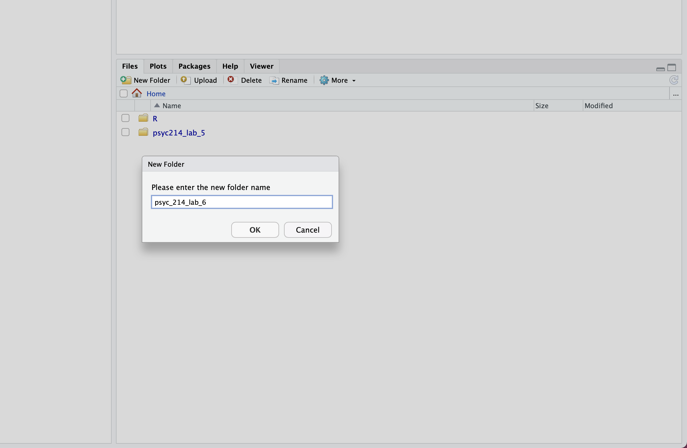
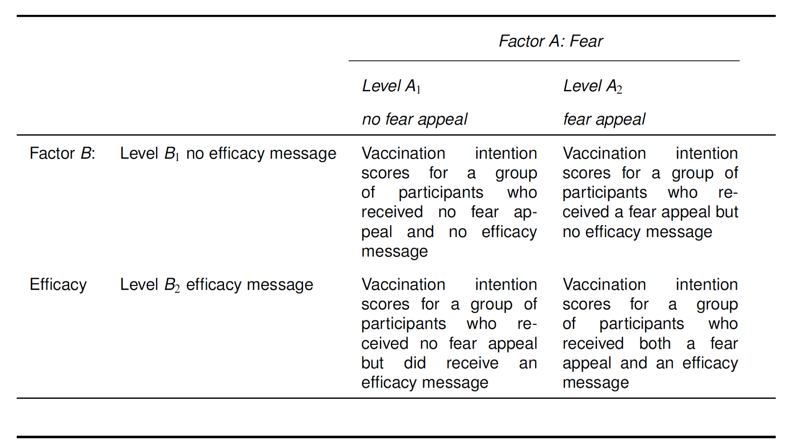
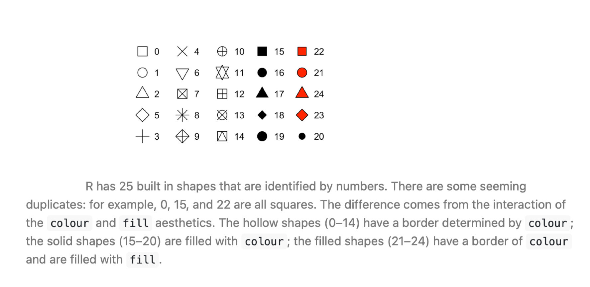

# Lectures

Hello! My name is Dr. Emma Mills, I am leading the 5141 content and labs from weeks 5 - 8. Each week there will be two lectures and each lecture will have associated lab activities.  Full disclosure, content is updated from two previous courses: PSYC204 and PSYC214 as we make a change both due to the CTP and across experimental software. This change is in its first stage this year, so content may feel a little disjointed between the two lectures.  Both strands are relevant, however and any lecture content could be in the final exam.

There are two lectures for week 5.  Each of the lectures have associated lab activities.

Lecture 1 introduces you to the dependent variable measure of response time, a simple and elegant measure for psychology experiments and one that is used by many third year students for their final year projects. It comes with important properties, of which you need to be aware.  This lecture introduces you to some of those.  Enjoy!

Lecture 2 continues your learning for Analysis of Variance methods (ANOVA) and introduces factorial design the ANOVA way.  The concepts for study design discussed here are important for study design generally.  They will be applied here in weeks 5-8 using the ANOVA analysis framework.  In 5242, we will also apply them but use a regression framework. On each occasion, you can reflect on the methods for your own project design for your final year project.

I have made continuous recordings. Each lecture has sections, however, with breaks indicated where you can pause to take refreshment etc.  But please watch both lectures in their entirety before your lab.

Watch Lecture 1 [here](https://lancaster.cloud.panopto.eu/Panopto/Pages/Viewer.aspx?id=87598da0-d18c-447a-9223-b4f00091dec1&start=0)

Download Lecture 1 slides [here](data/Wk6/5141_Lecture1_RT_Slides Week 5.pptx),

Watch Lecture 2 [here](https://lancaster.cloud.panopto.eu/Panopto/Pages/Viewer.aspx?id=ad18d9e4-4652-497b-97b2-b4f000ab1a03&start=0)

Download Lecture 2 slides[here](data/Wk6/5141_Lecture2_ANOVA_Slides Week 5.pptx).

# Practical

```{r setup, include=FALSE}
knitr::opts_chunk$set(echo = TRUE)
```

In weeks 1 - 4 for methods, you have considered single factor designed studies.  In weeks 5 - 8, the methods strand pivots to knowledge and understanding of the response time measure.  We will consider the RT measure and its properties this week, and in following weeks learn how to use it in an experiment in PsychoPy, a software programme that is simple to use to build experiments. We will also look at how to handle the RT data that arises from experiments so that should you wish to use RT as a measure in the future, you can.

In weeks 1 - 4 for statistics, we used single-factor ANOVA, and its non-parametric complementary methods to compare independent groups (between-participant) and repeated measurement (within-participant) design and data. From this week onwards, we extend the design from one factor to two or more factor study design while still using the ANOVA method.  There are no non-parametric methods that complement this level of design.  We will continue to practise planned comparisons, post-hoc tests, producing figures for reports and how to report your findings in text.

## This week's lab

The lab is in two parts:

Part 1: Using a virtual desktop, we will access the software PsychoPy and run the visual-perspective-taking (VPT) experiment as discussed in the last part of Lecture 1.  You will need a laptop for this exericse - so bring your student ID card and borrow a laptop for the sesssion if for any reason you do not have one.

Part 2: Turning to the statistical content, we will work with the 2 x 2 between-participant design that was discussed in the lecture in order to experience the concepts of factorial design for yourself and through the R code.

By the end of the lab you should be able to:

- Run and take part in the given VPT experiment in PsychoPy
- Reflect on concepts and properties of RT as a dependent measure as discussed in Lecture 1
- ?
- ?
- ?
- ?

Work through the code in your own R script, and try each activity before expanding **Check your answer**.

::: {.callout-note icon="false"}
## Session plan: 1 hour 50 mins

| Activity | Approximate time |
|---|---:|
| Set up | 10 minutes |
| Part 1: Task 1: Watch demonstration of the VPT experiment | 10 mins |
| Part 1: Task 2: Access virtual desktop, AppsAnywhere and PsychoPy | 20 minutes |
| Part 1: Run and take part in VPT experiment | 20 minutes |
| Part 1: Reflect on properties of RT as experienced during the VPT task | 15 minutes |
| Part 2: ANOVA 1 | 15 minutes |
| Part 2: ANOVA 2 | 15 minutes |
| Part 2: ANOVA 3 | 15 minutes |
| Summary, questions and catching up | 5 minutes |
:::

## Part 1: Experience of PsychoPy and the VPT Task

By the end of the class you should be able to:

- Run and take part in the given VPT experiment in PsychoPy
- Reflect on concepts around RT as a dependent measure as discussed in Lecture 1

### Task 1

Watch the demonstration of the experiment that you are going to run in PsychoPy so that you are familiar with the experiment screens when you get to them for yourself.

The video is narrated by Dr. Patrick May and is about 8 minutes long. Access it [here](https://lancaster.cloud.panopto.eu/Panopto/Pages/Viewer.aspx?id=903c00de-ea86-4683-aa9e-af4a01412af2)

### Task 2

This experiment is written in a version of PsychoPy from 2022. I have tested it, however and it does run
on the latest version (the one that is available to you today) via a *virtual desktop*, that emulates Lancaster University's Windows 11 environment.  So, I recommend that we run this part of the lab through a virtual desktop,

To do this easily,  READ THROUGH THIS ENTIRE SECTION BEFORE YOU BEGIN and then come back and follow the steps!

You can access your virtual desktop by clicking this link: [https://apps.lancaster.ac.uk](https://apps.lancaster.ac.uk)

Your computer screen should look like a desktop that you might see if you were to log on to a computer in the library.  Make sure that your actions are within this window from this point on.

After getting to your virtual desktop:

1. Open a web browser and navigate back to the stats webpage
2. In a second tab, go to AppsAnywhere: [https://apps.lancaster.ac.uk](https://apps.lancaster.ac.uk)
2. In the search bar of AppsAnywhere, type "PsychoPy 3"
3. Click on the blue Launch button
4. Back to the stats webpage in the  virtual desktop's web browser
5. Download the [VPT file](data/Wk6/VPT)
6. In the PsychoPy programme, using File > Open, find the "VPT.psyexp" files in the downloaded VPT file; click on this to load it into PsychoPy - let it work for a while.
7. Press the green arrow to run the file and wait. You may see a screen that look like this screenshot


   This is the programme as PsychoPy sees it; you need to press the green arrow button to run it.
8. Follow the instructions and participate faithfully in the task:
   - There is 1 block of practice trials
   - and 4 blocks of test trials
   
### Question 1

What is the sequence of a trial?

1. The picture of the avatar and dots and giving the response.
2. A perspective cue, a number of dots cue, a picture and response.
3. A fixation cross, a number of dots cue, a picture and response.
4. A picture, a perspective cue a number of dots cue and response.

::: {.callout-tip collapse="true"}
## Show answer

**Answer: 2. A perspective cue, a number of dots cue, a picture and response.**

The researchers made decisions to put the perspective cue before the number of dots cue; it is a research question in itself to know whether this order is impactful or could the order be reversed. Once this decision is made, however, its important that this is followed throughout the trials so that the participant can habituate to the order of the information so to give as much attention to the task in hand.
:::

### Question 2

How much time do participants have to respond?

1. Not enough - the response timeout is too short
2. Too much - the experiment was slow
3. Sufficient - the next trial seemed to roll over quickly after I responded
4. I cannot tell

::: {.callout-tip collapse="true"}
## Show answer

**Answer: 3. Sufficient - the next trial seemed to roll over quickly after I responded**

There was no response timeout programmed. You can tell this because trials did rollover on response. This is a consequential decision because if you do have a response timeout that is too long, then your participants may begin to use strategies to enhance their performance, when what we are looking for is an automatic response where we do not attach to much explicit thinking.  If we do want to motivate explicit thinking, then we are asking a different question and need a new design.
:::

### Question 3

How are responses made?

1. Right hand, index finger on B, middle finger on N
2. Two hands, index finger of left hand on B, index finder of right hand on N
3. Left hand, index finger on N, middle finger on B

::: {.callout-tip collapse="true"}
## Show answer

**Answer: 1. Right hand, index finger on B, middle finger on N**

In this version, the response key was set up for a right-handed person. A participant could ignore instructions and give their responses as in (2) - what implications does that have for their data? If you are left handed, did you feel a bit strange using your right hand to respond?  If you did, what implications are there for your data compared to a right-handed person? Would option (3) have worked better for you? These are all considerations that are needed for the design of such an experiment as this.
:::

### Question 4

How are response times measured in this task? From what point of the trial should response time be measured?

1. PsychoPy is programmed with a stopwatch, measurement begins from the end of the picture
2. PsychoPy is programmed with a stopwatch, measurement begins from the start of the picture
3. PsychoPy took my screen refresh rate information and makes an internal calculation when I press a response key, turning that into milliseconds for me, measurement begins from the end of the picture
4. PsychoPy took my screen refresh rate information and makes an internal calculation when I press a response key, turning that into milliseconds for me, measurement begins from the start of the picture

::: {.callout-tip collapse="true"}
## Show answer

**Answer: 4. PsychoPy took my screen refresh rate information and makes an internal calculation when I press a response key, turning that into milliseconds for me, measurement begins from the start of the picture**

Do you remember a screen that asked you to wait while PsychoPy measured your screen information? Within the software will be mini-programs that do all sorts of auxiliary tasks for you so that at the end of a data collection session, you have some nicely ordered and useable data (you probably still have to do some reshaping for R!). As discussed in the lecture, A is the stimulus onset - so the picture here is the stimulus and the onset is the start of the picture.  Logically, there is no "end" to the picture, until you respond - the picture is visible until you respond, if you chose the end of the picture that would put A (stimulus onset) and B (response time) on top of each other and you would get invalid data.
:::

### Question 5

Some trials had three dots on one wall only; other trials split three dots as two and one, using both walls. Is there a potential confound in this difference presentation of the trials with three dots?

1. No
2. I don't know - this is testable and we could run an experiment to check
3. I don't know - the span of three dots together on one wall is more dense than two or one and so the processing could be more expensive. this could lead to longer trials - which effects our DV of response time

::: {.callout-tip collapse="true"}
## Show answer

**Answer: 2 or 3**

This is a difficult question to answer. I certainly felt a difference when three dots were alongside each other rather than split across two walls.  In these situations, the stage at which this question is asked becomes salient: if before collecting data, you can run a pilot study to check; if while collecting data or when inspecting your data post data collection, you may need to run a further study to check.  This is all part of being a rigourous researcher.
:::

Other questions for your reflection:

 - Does the Egocentric and Altercentric effect seem real to you, having completed some trials for yourself. 
 - I am certain you made errors and were aware of those at the time.  Did you detect a "hangover" effect of those errors in subsequent trial responses? I know I did!
 
Next week, we will work inside this experiment and PsychoPy to adapt the experiment instructions, giving you a first try at working with the PsychoPy interface. So keep the files safe as you will need them.

## Part 2: Factorial Designs and Interactions in ANOVA

In this Week's lecture, we provided a conceptual introduction to factorial designs and interactions (deferring a discussion of the statistical mechanics of factorial ANOVA for future weeks). You learned that the outcomes of a factorial ANOVA include:

* **Main effects:** the mean differences among the levels of one factor are called the *main effect* of that factor. Main effects provide information about the independent effects of each factor. A two-factor study has two main effects, one for each of the two factors.

* **Interaction:** sometimes, one factor has a direct influence on the effect of a second factor, producing an *interaction between factors*. An interaction occurs whenever two factors, acting together, produce mean differences not explained by the main effects of the two factors.

* **Simple main effects:** the *simple main effects* break down the main effects into their component parts. They reveal the effect of one factor at each level of the second factor. A simple main effects analysis allows us to determine how two factors are combining to influence the dependent variable.

In factorial designs, data visualization becomes even more important than in single-factor designs. If a factorial ANOVA produces a significant interaction, then the easiest way to interpret it is by graphing the data in terms of an *interaction plot* and studying the simple main effects. Interaction plots are either graphed as line plots, like the ones presented in the lecture, or as bar plots. In this lab class, we will show you how to generate both kinds of plots in an appropriate format for presenting in your reports. You will also obtain experience of detecting/interpreting interactions by looking at each of the simple main effects in graphed data.

# Getting Started



Once you are logged into the server, create a folder for today's session. Navigate to the bottom right panel (see figure below) and under the `Files` option select the `New Folder` option. Name the new folder `psyc214_lab_6`. **Please ensure that you spell this correctly** otherwise when you set the directory using the command given below it will return an error.

{width=75%}

Now that you have created a folder for today's session, it’s time to add the Week 6 data file. Download the data file [fearVac.csv here](data/Wk6/fearVac.csv). Next, in the RStudio Server open your new pscy214_lab_6 folder. When in the new folder, select the `Upload` tab. This will present a box that will ask where the data is that you want to upload. Click on `Browse`, find the `fearVac.csv` file on your desktop and click `OK`.

Se we can save this session on the server, click `File` on the top ribbon and select `New project`. Next, select existing directory and name the working directory `~/psyc214_lab_6` before selecting `create project`.

Finally, open a script for executing today's coding exercises. Navigate to the top left pane of RStudio, select `File` -> `New File` -> `R Script`. Working from a script will make it easier to edit your code and you will be able to save your work for a later date.

{width=75%}

Let's set our working directory:

```{r eval = FALSE}
setwd("~/psyc214_lab_6")
```

Before moving on, let's load the relevant libraries that we will be using in today's session.

```{r, message=FALSE}
library("tidyverse")
library("rstatix")
```

## Today's Lab Activities

### A 2 $\times$ 2 factorial study

Let's start by revisiting the COVID-19 vaccination example presented in the lecture. In that example, a researcher is interested in identifying effective strategies for encouraging members of the general public to get vaccinated against COVID-19. The researcher decides to test an often employed intervention to reduce risky intentions or behaviours known as a **fear appeal**. A fear appeal is a persuasive message that attempts to induce fear in message recipients by emphasizing the potential danger and harms that will befall them if they do not adopt the messages' recommendations. Graphic images on cigarette packages (e.g., a diseased eye, cancerous lungs, or a damaged heart) encouraging people to quit smoking are a classic example of a fear appeal. The researcher crafts a fear appeal---a short verbal message---drawing people's attention to the various risks associated with contracting COVID-19, including long-term debilitating symptoms (so-called "long COVID") such as lack of attention, concentration, and lethargy, as well as potential death. The researcher includes in the message a graphic image of a patient in a distressed state on a ventilator in a hospital bed. The researcher wants to know if a group of participants that receive the fear appeal express a greater intention to get vaccinated against COVID-19 than a group of participants that do not receive the fear appeal. The researcher plans to measure such intentions by asking people how likely it is that they would get vaccinated against COVID-19 on a scale ranging from 0 (Very Unlikely) to 10 (Very Likely).

However, the researcher knows that for fear appeals to be effective, they typically must be accompanied by a **self-efficacy message**---a statement that assures message recipients that they are capable of performing the fear appeal's recommended actions and/or that performing the recommended actions will result in desirable consequences. For example, cigarette packets as well as arousing fear using graphic images also direct smokers to resources to help them to quit smoking and highlight the benefits of doing so (the self-efficacy message component). Accordingly, the researcher creates a self-efficacy message that emphasizes to message recipients how easy it is for them to get vaccinated, how to do so, and the benefits that will be obtained once they have been immunized.

The researcher wants to know what independent or interactive effects the fear appeal and self-efficacy message may have on COVID-19 vaccination intentions, so she decides to run a 2 $\times$ 2 fully between-participants factorial study involving a total of *N* = 200 participants, with the following factors:

* **Fear:** no fear appeal vs. fear appeal
* **Efficacy:** no efficacy message vs. efficacy message

This results in four different groups of participants. One group (*N* = 50) receives *no fear appeal* and *no efficacy message*. A second group (*N* = 50) receives the *fear appeal* but *no efficacy message*. A third group (*N* = 50) receives *no fear appeal* but does receive an *efficacy message*. A fourth group (*N* = 50) receives both the *fear appeal* and the *efficacy message*. All groups of participants then indicate their intention to vaccinate against COVID-19 using the vaccination intention measure described above. The four conditions are summarized in the table below.

{width=75%}

First things first, let's load the data set and view it:

```{r, message = FALSE, eval=FALSE}
# Import the data
vacData = read_csv("fearVac.csv")
# View the data
(vacData)
```

```{r, message = FALSE, echo=FALSE}
# Import the data
vacData = read_csv("data/Wk6/fearVac.csv")
# View the data
(vacData)
```

Take a look at the table summarising the data. Beneath each variable name, R tells us the variable type. There is an issue here in that the variables `Fear` and `Efficacy` are designated as character variables `<chr>`. This simply means that they are represented as strings of text. However, we want these variables to be represented as factors `<fct>`. Furthermore, we want to re-order the levels of each factor, as R will otherwise represent these in alphabetical order, which is not what we want. For `Fear`, we want the levels to-be-ordered "no fear appeal" --> "fear appeal" and for `Efficacy` we want the levels to-be-ordered "no efficacy message" --> "efficacy message". Sam has shown you how to do this a few times before in previous labs, so try figuring this one out for yourselves.

```{r, message = FALSE, echo = FALSE}
# Convert "Fear" and "Efficacy" into factors
# Ensure that "No Fear Appeal" IS Level 1 of the Fear factor and "No Efficacy Message" is Level 1 of the Efficacy factor
vacData$Fear     = factor(vacData$Fear, levels = c("No Fear Appeal","Fear Appeal"))
vacData$Efficacy = factor(vacData$Efficacy, levels = c("No Efficacy Message","Efficacy Message"))
```

::: {.callout-warning icon="false" collapse="true"}
## Answer

```{r, message = FALSE}
# Convert "Fear" and "Efficacy" into factors
# Ensure that "No Fear Appeal" IS Level 1 of the Fear factor and "No Efficacy Message" is Level 1 of the Efficacy factor
vacData$Fear     = factor(vacData$Fear, levels = c("No Fear Appeal","Fear Appeal"))
vacData$Efficacy = factor(vacData$Efficacy, levels = c("No Efficacy Message","Efficacy Message"))
```

:::

Right, lets take a look at our data set again to see if this code has had the desired effect:

```{r}
(vacData)
```

Look at the variable type beneath the variable name. Notice that the `Fear` and `Efficacy` variables are now represented as factors <fct> as we requested.

You can inspect the full data set by typing `view(data)` in the console. I suggest you do this now, so that you can see how the data is organized.

Now we have inspected the raw data, let's generate some descriptive statistics for our four conditions, which we will store in a dataframe called `descriptives`. Specifically, we want the number of cases `n`, the `mean`, the standard deviation `sd`, the standard error `se`, and the confidence intervals `ci`. Once again, I'm going to hand this one over to you guys. Remember to call your dataframe `descriptives`. Hint: you will need to use `group_by` and select the relevant variables for which to generate the descriptive statistics.

```{r, message = FALSE, echo = FALSE}
# Generate descriptive statistics for the four conditions
descriptives = vacData %>%
  # Organise output by Fear and Efficacy
  group_by(Fear,Efficacy) %>%
  # Get the mean, sd, se, and ci
  get_summary_stats(Intention, show = c("mean", "sd", "se", "ci"))
  # Round the results to *at least* two-decimal places
  options(digits = 5)
  # Print the results
  print.data.frame(descriptives)
```

::: {.callout-warning icon="false" collapse="true"}
## Answer

```{r, message=FALSE}
descriptives = vacData %>%
  # Organise output by Fear and Efficacy
  group_by(Fear,Efficacy) %>%
  # Get the mean, sd, se, and ci
  get_summary_stats(Intention, show = c("mean", "sd", "se", "ci"))
  # Round the results to *at least* two-decimal places
  options(digits = 4)
  # Print the results
  print.data.frame(descriptives)
```

:::

## Plotting line graphs

Okay, now we have our descriptive statistics let's get plotting the data!

In most statistics textbooks, the standard advice when it comes to plotting the results of a factorial experiment is that you should use a line plot, like the ones in the lecture, as this makes it easier to spot an interaction (or lack thereof) between factors. As well as plotting the means, we also want to include error bars illustrating the variability in the data. In the example next, we are using standard errors. Run the following code and it should produce the graph below. Pay attention to the comments in the code, so it is clear what each element is doing.

```{r, warning = FALSE}
# jitt is used later to add a small amount of spatial jitter to our lines, data points, and error bars to prevent them from overlapping
jitt = position_dodge(0.1)
# Using the dataframe called descriptives, place "Fear" on the x-axis, "mean" on the y-axis, and group the data
# according to the two levels of the "Efficacy" factor
ggplot(data = descriptives, mapping = aes(x = Fear, y = mean, group = Efficacy)) +
    # geom_line produces two lines: one for "no efficacy message" and one for "efficacy message"
    geom_line(size = 1, position = jitt, aes(color = Efficacy)) +
    # geom_point adds mean data points to our lines
    geom_point(size = 3, position = jitt, aes(color = Efficacy)) +
    # geom_errorbar adds error bars to our geom_points - here we are using the standard error
    geom_errorbar(position = jitt, mapping = aes(ymin = mean - se, ymax = mean + se, color = Efficacy), size = 1, width = .05) +
    # Here we are manually setting the colour of the lines, data points, and error bars
    scale_color_manual(values=c("#355C7D", "#F67280")) +
    # Change y-axis lower and upper limits
    ylim(0,10) +
    # Manually set the x- and y-axis titles
    labs(x = "Fear", y = "Vaccination Intention") +
    # Use black and white theme for background
    theme_bw() +
    # The theme function allows us to set various properties of our figure manually
    theme(panel.grid.major = element_blank(), # Removes the major gridlines
          panel.grid.minor = element_blank(), # Removes the minor gridlines
          legend.box.background = element_rect(colour = "black"), # Adds a black border around the legend
          legend.position = "bottom", # Positions the legend at the bottom of the graph
          legend.direction = "vertical") # Orients the legend in the vertical direction
```

This looks good. At this point, we might wish to save our figure so that we can export it elsewhere (e.g., a Word document or a PowerPoint presentation). Arguably, the most useful file format for this purpose is the Portable Network Graphic, or PNG for short. You can save the graph as a PNG file as follows:

```{r}
ggsave("FearAppealLinePlot.png", height = 6, width = 5, dpi = 300)
```

As you can see, we need to specify a name for the file, "FearAppealLinePlot.png", that includes the .png extension at the end. We also have the option of specifying the desired height and width of the figure in inches, and the dpi, which stands for  "Dots-Per-Inch" and corresponds to the resolution of the image. I recommend always setting the dpi to 300.

Let's take a closer look at the line graph we have produced. Remember from the lecture that a useful way to spot an interaction in a line graph is to determine whether the lines are parallel or not. If the lines are non-parallel, then this is an indication of the presence of an interaction. In our case, the lines are indeed non-parallel, suggesting that the fear and efficacy factors are combining with one another to influence the dependent variable. To break down the interaction, we can look at the simple main effects (if you have forgotten what these are, you may want to consult the lecture slides).

For these data, there are four simple main effects. For simplicity, we will characterise these effects using the operators `=`, `<`, and `>`. For example, condition A `=` condition B implies that the means for the two conditions are (roughly) the same; condition A `<` condition B implies that the mean for condition A is less than the mean for condition B; whereas condition A `>` condition B implies that the mean for condition A is greater than the mean for condition B. We will treat relatively small differences between means as indicating that they do not differ, with relatively large differences between means indicating that they do differ.

For our data, there are four simple main effects (two for the fear factor and two for the efficacy factor):

* The simple main effect of *fear* (no fear appeal *vs.* fear appeal), at the *no efficacy message* level of the efficacy factor: **no fear appeal = fear appeal**

* The simple main effect of *fear* (no fear appeal *vs.* fear appeal), at the *efficacy message* level of the efficacy factor: **no fear appeal < fear appeal**

* The simple main effect of *efficacy* (no efficacy message *vs.* efficacy message), at the *no fear appeal* level of the fear factor: **no efficacy message = efficacy message**

* The simple main effect of *efficacy* (no efficacy message *vs.* efficacy message), at the *fear appeal* level of the fear factor: **no efficacy message < efficacy message**

The simple main effects indicate that the effect of the fear factor varies according to the different levels of the efficacy factor (and vice versa), which is indicative of an interaction between the two factors.

More specifically, what the data show is that in the absence of a self-efficacy message, there is no effect of the fear appeal on vaccination intentions; that is, vaccination intentions do not differ between the no fear appeal and fear appeal conditions. However, in the presence of a self-efficacy message there is an effect of the fear appeal on vaccination intentions; that is, vaccination intentions are higher in the fear appeal condition than in the no fear appeal condition.

Thus, our data suggest that fear appeals are an effective strategy for increasing COVID-19 vaccination intentions, provided that they are accompanied by a self-efficacy message.

Before moving on, I will emphasise, as I did in the lecture, that we would not know for certain whether there "really" is an interaction until we subjected our data to a factorial ANOVA and looked at the significance value of the interaction effect.

**Back to plotting!**

I'm a big fan of using colour in graphs, but unfortunately the APA doesn't share this sentiment. The APA guidlines state that you should not use colour in your figures, so I have been a very naughty boy by adding a touch of colour to my figure. We can easily resolve this by changing the hexademical codes for our colours to black and grey (#000000, #CCCCCC). The problem is that if we have more than two factors, and hence more than two lines in our plot, we have to use different shades of grey for at least two of the lines, and it can sometimes become difficult to visually distinguish them.

Another approach is to keep the colour of the lines identical (e.g., black) but vary the shape of the mean data points. In our current line graph, we used circles (or dots) as the markers for our mean data points. However, as can be seen from the figure below, there are various different shapes we can use in our plots.

{width=100%}

Now, we will generate our line graph again but this time using different shapes (circles vs. squares) rather than different colours to distinguish the different lines for the no efficacy message and efficacy message levels of the `Efficacy` factor. The code below is very similar to that which we used earlier, so for clarity I have only commented on those elements that have changed.

```{r, message=FALSE, warning=FALSE}
jitt = position_dodge(0.1)
ggplot(data = descriptives, mapping = aes(x = Fear, y = mean, group = Efficacy)) +
  # Here is the main bit of code that has changed from the last figure.
  # Previously we used aes(color = Efficacy) in geom_line and geom_point to
  # tell R to produce different colors for each level of the efficacy factor.
  # Now we are using aes(shape = Efficacy), which tells R to use different shapes instead.
  # Note also the custom specification of shapes below.
  ########################################################################
  geom_line(size = 1, position = jitt, aes(shape = Efficacy)) +
  geom_point(size = 3, position = jitt, aes(shape = Efficacy)) +
  # Custom values for the shapes: 15 = a black square, 16 = a black circle
  scale_shape_manual(values = c(15, 16)) +
  ########################################################################
  geom_errorbar(position = jitt, mapping = aes(ymin = mean - se, ymax = mean + se, color = Efficacy), size = 1, width = .05) +
  # We are also manually setting the color of both lines, data points, and error bars to black
  scale_color_manual(values=c("#000000", "#000000")) +
  ylim(0,10) +
  labs(x = "Fear", y = "Vaccination Intention") +
  theme_bw() +
  theme(panel.grid.major = element_blank(),
        panel.grid.minor = element_blank(),
        legend.box.background = element_rect(colour = "black"),
        legend.position = "bottom",
        legend.direction = "vertical")
```

Ideally, I would like the data points to be larger in this figure. You can do this by adjusting the size argument in `geom_point` above---it's currently set to a value of 3, which is quite small. However, if we increase it further it will obscure our standard error error bars. The solution is that we could plot the standard deviation in the error bars instead (but they take up a lot of visualization space) or the confidence intervals (which will be a bit bigger than the standard errors). I recommend the latter. We requested both of these descriptive statistics earlier, so if you wanted to replot the data with confidence intervals, then you would change `se` to `ci` (there are two of these values that must be changed) in the call to geom_errorbar and increase the size value in geom_point to, say, 5 or 6.

Okay, that's enough of line plots for now---let's look at how to plot the same data as a bar graph instead.

## Plotting bar graphs

Although most textbooks will recommend that you plot the results of a factorial experiment as a line graph, in practice bar graphs are a popular option too. There are no rules regarding which type of graph you should use, so I recommend plotting the type that you find easiest to read. Personally, I find bar graphs easier to read than line graphs. Bar graphs tend to work well when you have factors with a small number of levels, but when you have one or more factors with many levels, a line graph will typically be a better option.

Let's plot the results of our factorial study as a bar graph. You can do so using the following code (again, be sure to read the code comments so it is clear what each line of code is doing):

```{r}
# Using the dataframe called descriptives, place "Fear" on the x-axis, "mean" on the y-axis, and group the data
# according to the two levels of the "Efficacy" factor
ggplot(data = descriptives, mapping = aes(x = Fear, y = mean, fill = Efficacy)) +
  # geom_col is used to create our bar plots. Width and position_dodge control the width and degree of spatial
  # separation of the bars, respectively
  geom_col(width = 0.45, position = position_dodge(0.55)) +
  # geom_errorbar adds error bars to our geom_cols - here we are using the standard error
  geom_errorbar(mapping = aes(ymin = mean - se, ymax = mean + se),
      size = .5, width = .1, position = position_dodge(.55)) +
  # Here we are manually setting the colour of the columns and error bars
  scale_fill_manual(values = c("#355C7D", "#F67280")) +
  # We are using scale_y_continuous this time to set the y-axis limits because we want to remove the
  # white space that ggplot leaves between 0 and the x-axis line using expand = c(0,0).
  scale_y_continuous(limits = c(0,10.5), expand = c(0,0)) +
  # Manually set the x- and y-axis titles
  labs(x = "Fear", y = "Vaccination Intention") +
  # Use black and white theme for background
  theme_bw() +
  # The theme function allows us to set various properties of our figure manually
  theme(panel.grid.major = element_blank(), # Removes the major gridlines
        panel.grid.minor = element_blank(), # Removes the minor gridlines
        legend.box.background = element_rect(colour = "black"), # Adds a black border around the legend
        legend.position = "bottom", # Positions the legend at the bottom of the graph
        legend.direction = "vertical") # Orients the legend in the vertical direction
```

How would you spot an interaction in a bar graph? Imagine that there are two lines: one resting on top of the blue bars and one resting on top of the pink bars. If those lines are non-parallel, then you most probably have an interaction.

I couldn't resist using some colour once again in our bar graph, but just a reminder that for plotting graphs for your lab reports or third year dissertation you should use APA compatible colours, such as black and grey (#000000, #CCCCCC). Colour is set in ggplot using either named colours or more commonly hexadecimal colour codes (as we have been using here). If you search online for "hexadecimal colour palettes" it will return images containing a selection of colours and the hexadecimal codes for using them in ggplot. Try the following resource: http://derekogle.com/NCGraphing/resources/colors.

The colours I have used here were taken from the palette below, which I accessed online (there are many other palettes to choose from if you are fussy about colours, which I tend to be---I'm just a fussy person in general).

{width=100%}

Before moving on, let's save our most recent figure.

```{r}
ggsave("FearAppealBarPlot.png", height = 6, width = 5, dpi = 300)
```

## Plotting multiple graphs and interpreting simple main effects

Sometimes, we want to plot multiple graphs within the same figure. In ggplot, we can plot multiple graphs using the `facet_wrap` command, which you may have encountered in Richard's lab classes. For the first example, I am going to generate three different line plots in the same figure, each illustrating an interaction between factors. I am then going to get you to identify the simple main effects in each graph, as we did earlier.

In this example, we have three examples of alternative hypothetical interactions between the `Fear` and `Efficacy` manipulations for our COVID-19 experiment. The data are contained in the following tibble (note, we already have the means, so we don't need to generate any descriptive statistics):

```{r}
threeInteractions = tibble(
  Example = c("A","A","A","A","B","B","B","B","C","C","C","C"),
  Fear = c("No Fear Appeal","No Fear Appeal","Fear Appeal","Fear Appeal",
        "No Fear Appeal","No Fear Appeal","Fear Appeal","Fear Appeal",
        "No Fear Appeal","No Fear Appeal","Fear Appeal","Fear Appeal"),
  Efficacy = c("No Efficacy Message","Efficacy Message","No Efficacy Message","Efficacy Message",
        "No Efficacy Message","Efficacy Message","No Efficacy Message","Efficacy Message",
        "No Efficacy Message","Efficacy Message","No Efficacy Message","Efficacy Message"),
  Mean  = c(4.2,9,4,4.5,4.75,5.25,1,9,2,8,8,2)
)
# Make sure "Example", "Fear", and "Efficacy" are coded as factors
threeInteractions$Example  = factor(threeInteractions$Example) # "Example" is already organised alphabetically,
# which is what we want
threeInteractions$Fear     = factor(threeInteractions$Fear, levels = c("No Fear Appeal","Fear Appeal"))
threeInteractions$Efficacy = factor(threeInteractions$Efficacy, levels = c("No Efficacy Message","Efficacy Message"))
```

Let's take a look at the means:
```{r}
(threeInteractions)
```

We want to generate a single figure that contains three graphs in different panels, one panel for example A, one panel for example B, and one panel for example C. The code required to generate the figure is much the same as for our initial line graph example, but we are now going to use the command `facet_wrap(Example)` to instruct ggplot to generate separate graphs for each of our three examples of an interaction. The code for generating the figure is below:

```{r}
# Using the dataframe called threeInteractions, place "Fear" on the x-axis, "Mean" on the y-axis,
# and group the data according to the two levels of "Efficacy"
ggplot(data = threeInteractions, mapping = aes(x = Fear, y = Mean, group = Efficacy)) +
  # geom_line produces two lines: one for "No Efficacy Message" and one for "Efficacy Message"
  geom_line(size = 1, aes(color = Efficacy)) +
  # geom_point adds mean data points to our lines
  geom_point(size = 3, aes(color = Efficacy)) +
  # Here we are manually setting the colour of the lines and data points
  scale_color_manual(values=c("#355C7D", "#F67280")) +
  # This tells ggplot to plot the figure with different panels for Examples A, B, and C on a single row.
  # You can also specify the number of columns as an option.
  ###################################
  facet_wrap(~Example, nrow = 1) +
  ###################################
  # Change y-axis lower and upper limits
  ylim(0,10) +
  # Manually set the x-axis, y-axis, and legend titles
  labs(x = "Fear", y = "Vaccination Intention", color = "Efficacy") +
  # Use black and white theme for background
  theme_bw() +
  # The theme function allows us to set various properties of our figure manually
  theme(panel.grid.major = element_blank(), # Removes the major gridlines
        panel.grid.minor = element_blank(), # Removes the minor gridlines
        legend.box.background = element_rect(colour = "black"), # Adds a black border around the legend
        legend.position = "bottom", # Positions the legend at the bottom of the graph
        legend.direction = "vertical") # Orients the legend in the vertical direction
```

Right, this is a good point to give you some practice extracting simple main effects. So, for each of the examples I want you to identify the pattern of the four simple main effects as we did earlier using the `=`, `<`, and `>` operators. Don't worry if you find this a bit tricky, it takes some time to get your head around simple main effects. If you get stuck, give us a shout!

### Example A

* Simple main effect of Fear at the No Efficacy Message level of Efficacy: **No Fear Appeal = Fear Appeal**

* Simple main effect of Fear at the Efficacy Message level of Efficacy: _______

* Simple main effect of Efficacy at the No Fear Appeal level of Fear: _______

* Simple main effect of Efficacy at the Fear Appeal level of Fear _______

### Example B

* Simple main effect of Fear at the No Efficacy Message level of Efficacy: _______

* Simple main effect of Fear at the Efficacy Message level of Efficacy: _______

* Simple main effect of Efficacy at the No Fear Appeal level of Fear: _______

* Simple main effect of Efficacy at the Fear Appeal level of Fear _______

### Example C

* Simple main effect of Fear at the No Efficacy Message level of Efficacy: _______

* Simple main effect of Fear at the Efficacy Message level of Efficacy: _______

* Simple main effect of Efficacy at the No Fear Appeal level of Fear: _______

* Simple main effect of Efficacy at the Fear Appeal level of Fear _______

::: {.callout-warning icon="false" collapse="true"}
## Answer

### Example A

* Simple main effect of Fear at the No Efficacy Message level of Efficacy: **No Fear Appeal = Fear Appeal**

* Simple main effect of Fear at the Efficacy Message level of Efficacy: **No Fear Appeal > Fear Appeal (or Fear Appeal < No Fear Appeal)**

* Simple main effect of Efficacy at the No Fear Appeal level of Fear: **No Efficacy Message < Efficacy Message (or Efficacy Message > No Efficacy Message)**

* Simple main effect of Efficacy at the Fear Appeal level of Fear: **No Efficacy Message = Efficacy Message**

### Example B

* Simple main effect of Fear at the No Efficacy Message level of Efficacy: **No Fear Appeal > Fear Appeal (or Fear Appeal < No Fear Appeal)**

* Simple main effect of Fear at the Efficacy Message level of Efficacy: **No Fear Appeal < Fear Appeal (or Fear Appeal > No Fear Appeal)**

* Simple main effect of Efficacy at the No Fear Appeal level of Fear: **No Efficacy Message = Efficacy Message**

* Simple main effect of Efficacy at the Fear Appeal level of Fear: **No Efficacy Message < Efficacy Message (or Efficacy Message > No Efficacy Message)**

### Example C

* Simple main effect of Fear at the No Efficacy Message level of Efficacy: **No Fear Appeal < Fear Appeal (or Fear Appeal > No Fear Appeal)**

* Simple main effect of Fear at the Efficacy Message level of Efficacy: **No Fear Appeal > Fear Appeal (Fear Appeal < No Fear Appeal)**

* Simple main effect of Efficacy at the No Fear Appeal level of Fear: **No Efficacy Message < Efficacy Message (or Efficacy Message > No Efficacy Message)**

* Simple main effect of Efficacy at the Fear Appeal level of Fear: **No Efficacy Message > Efficacy Message (or Efficacy Message < No Efficacy Message)**

:::

Before moving on, let's save our most recent figure.

```{r}
ggsave("ThreeInteractionsLinePlot.png", height = 6, width = 8, dpi = 300)
```

Okay, we are almost finished but I want to conclude the activities by showing you how to create multiple bar graphs within the same figure. We will once again use the data illustrating the three different types of interactions. The code required to generate the figure is much the same as for our initial bar graph example, but we are now going to use the command `facet_wrap(Example)` to instruct ggplot to generate separate graphs for each of our three examples of an interaction. The code for generating the figure is below:

```{r}
# Using the dataframe called threeInteractions, place "Fear" on the x-axis, "Mean" on the y-axis,
# and group the data according to the two levels of "Efficacy"
ggplot(data = threeInteractions, mapping = aes(x = Fear, y = Mean, fill = Efficacy)) +
  # geom_col is used to create our bar plots. Width and position_dodge control the width and degree of spatial
  # separation of the bars, respectively
  geom_col(width = 0.45, position = position_dodge(0.55)) +
  # Here we are manually setting the colour of the columns
  scale_fill_manual(values = c("#355C7D", "#F67280")) +
  # This tells ggplot to plot the figure with different panels for Examples A, B, and C on a single row.
  # You can also specify the number of columns as an option.
  ###################################
  facet_wrap(~Example, nrow = 1) +
  ###################################
  # We are using scale_y_continuous this time to set the y-axis limits because we want to remove the
  # white space that ggplot leaves between 0 and the x-axis line using expand = c(0,0).
  scale_y_continuous(limits = c(0,10.5), expand = c(0,0)) +
  # Manually set the x-axis, y-axis, and legend titles
  labs(x = "Fear", y = "Vaccination Intention", fill = "Efficacy") +
  # Use black and white theme for background
  theme_bw() +
  # The theme function allows us to set various properties of our figure manually
  theme(panel.grid.major = element_blank(), # Removes the major gridlines
        panel.grid.minor = element_blank(), # Removes the minor gridlines
        legend.box.background = element_rect(colour = "black"), # Adds a black border around the legend
        legend.position = "bottom", # Positions the legend at the bottom of the graph
        legend.direction = "vertical") # Orients the legend in the vertical direction
```

Before closing, let's save our most recent figure to the directory.

```{r}
ggsave("ThreeInteractionsBarPlot.png", height = 6, width = 8, dpi = 300)
```

There are a couple of additional things I should mention regarding graphs. Statistics textbooks generally recommend that you should only plot all of the data, which is necessary to discern an interaction, if you actually have a significant interaction, otherwise you should plot whatever main effects are significant. I strongly disagree with this recommendation and it seems that most other researchers do as well because I rarely if ever see this advice being followed in published research. Whether your interaction is significant or not, I recommend graphing all of the data, simply because that gives your audience a complete picture of the results. Thus, even if only the main effects are significant you should plot all the results, so both the significant main effects and the absence of a significant interaction are visible to your audience. The other thing to mention is that a graph is generally always preferred to presenting your results in a table for the simple reason that "a picture speaks a thousand words"---graphs are easier to read than tables. And remember, APA style dictates that we can't present the same data in different formats---that is, you should not present the same data as both a table and a graph. When forced to choose, graphs win hands down. Just make sure you include both the means and a measure of variability (e.g., standard deviation, standard error, or confidence interval) in the form of error bars.

Okay, that's the end of the exercises for today's session. Well done! **Please bear in mind, we will be using the code employed today in future sessions to generate the plots for our data, but I won't give you the code---you will have to adpat the code I have given you here.**

## Further tasks
If you still have time remaining, consider completing the following activity. In all of the plotting exercises above we used the `theme` function in ggplot to set various properties of our plots (see the bottom of each code segment). This function is incredibly useful and can be used to change all the non-data components of a plot (titles, labels, fonts, background, gridlines, and legends). To learn more about the arguments that `theme` accepts, type help(theme) into the console. Your additional tasks, should you choose to accept them, are as follows. Modify the code we used to generate the first line plot so that:

* The x-axis title (i.e., Fear) is presented in size 14 bold font.
* The x-axis text (i.e., No Fear Appeal, Fear Appeal) is presented in size 12 black font.
* The y-axis title (i.e., Vaccination Intention) is presented in size 14 bold font.
* The y-axis text (i.e., the numbers on the y-axis) is presented in size 12 black font.
* The legend title (i.e., Efficacy) is presented in size 14 bold font.

::: {.callout-warning icon="false" collapse="true"}
## Answer

```{r, echo = TRUE}
# jitt is used later to add a small amount of spatial jitter to our lines, data points, and error bars to prevent them from overlapping
jitt = position_dodge(0.1)
# Using the dataframe called descriptives, place "Fear" on the x-axis, "mean" on the y-axis, and group the data
# according to the two levels of the "Efficacy" factor
ggplot(data = descriptives, mapping = aes(x = Fear, y = mean, group = Efficacy)) +
    # geom_line produces two lines: one for "no efficacy message" and one for "efficacy message"
    geom_line(size = 1, position = jitt, aes(color = Efficacy)) +
    # geom_point adds mean data points to our lines
    geom_point(size = 3, position = jitt, aes(color = Efficacy)) +
    # geom_errorbar adds error bars to our geom_points - here we are using the standard error
    geom_errorbar(position = jitt, mapping = aes(ymin = mean - se, ymax = mean + se, color = Efficacy), size = 1, width = .05) +
    # Here we are manually setting the colour of the lines, data points, and error bars
    scale_color_manual(values=c("#355C7D", "#F67280")) +
    # Change y-axis lower and upper limits
    ylim(0,10) +
    # Manually set the x- and y-axis titles
    labs(x = "Fear", y = "Vaccination Intention") +
    # Use black and white theme for background
    theme_bw() +
    # The theme function allows us to set various properties of our figure manually
    theme(panel.grid.major = element_blank(), # Removes the major gridlines
          panel.grid.minor = element_blank(), # Removes the minor gridlines
          legend.box.background = element_rect(colour = "black"), # Adds a black border around the legend
          legend.position = "bottom", # Positions the legend at the bottom of the graph
          legend.direction = "vertical", # Orients the legend in the vertical direction
          ##########################################################################
          # What follows is the extra bit of code needed to make the above changes #
          ##########################################################################
          axis.title.x = element_text(size = 14, face = "bold"), # Adjusts font style and size of x-axis label
          axis.text.x = element_text(size = 12, color = "black"), # Adjusts size and colour of x-axis text
          axis.title.y = element_text(size = 14, face = "bold"), # Adjusts font style and size of y-axis label
          axis.text.y = element_text(size = 12, color = "black"), # Adjusts size and colour of y-axis text
          legend.title = element_text(size = 14, face = "bold")) # Adjusts font style and size of legend title
```

:::

Well done folks! We've covered a lot of ground today, that's all until our next session. Enjoy the rest of the week!
<br>
<br>

